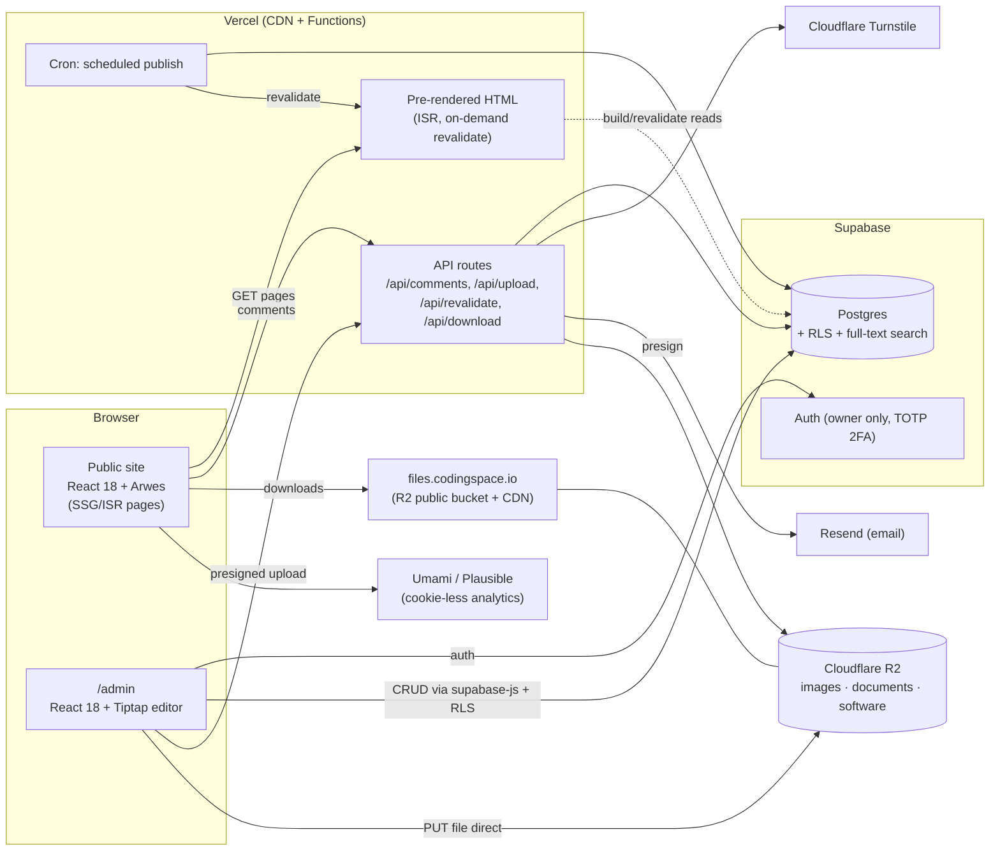
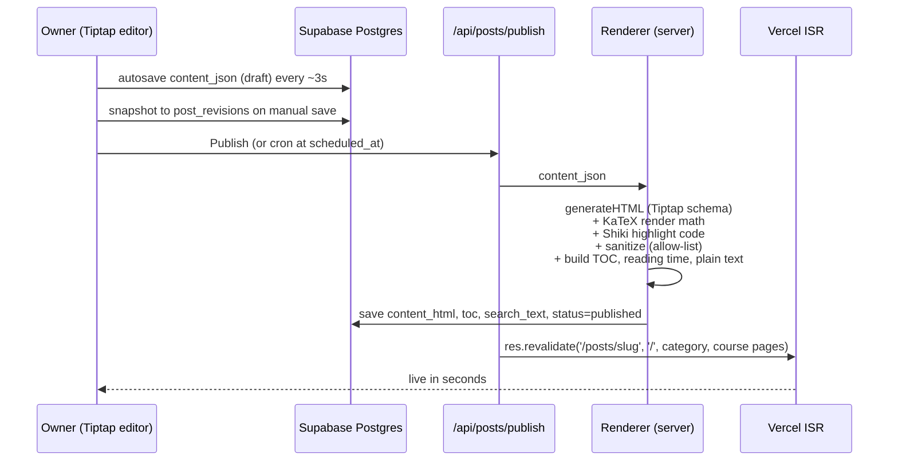
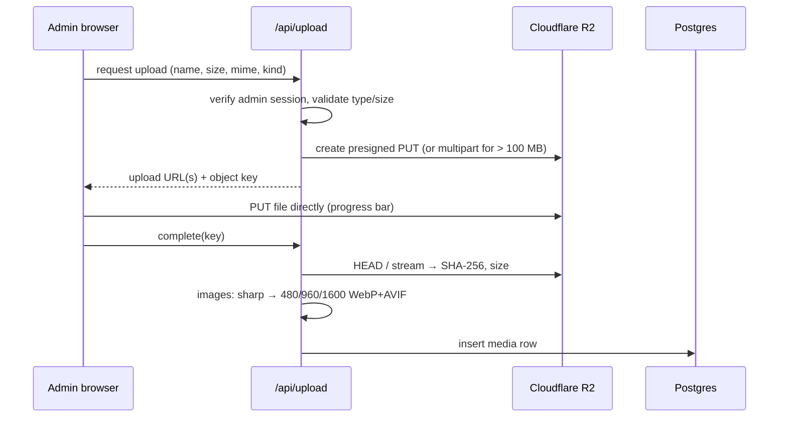
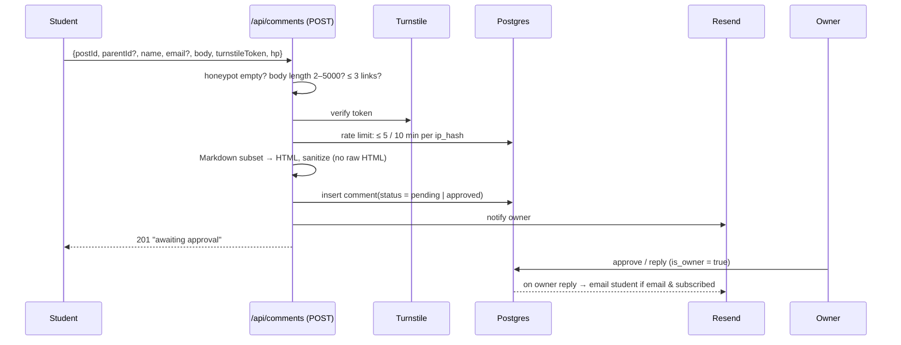
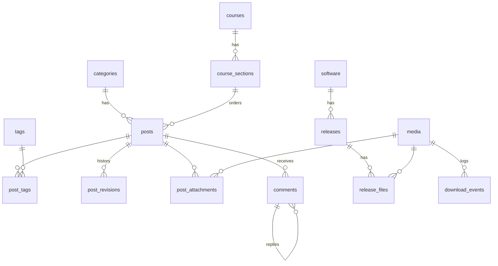

# CodingSpace (codingspace.io) — System Architecture

> **Superseded.** The current baseline is [03-system-analysis.md](./03-system-analysis.md), with the build plan in [04-milestones.md](./04-milestones.md). This file is kept as history.

Companion to [01-system-requirements.md](./01-system-requirements.md). Version 0.2 — 2026-10-15.

> **v0.2 scope changes (owner decisions, 2026-10-15).** Where the sections below differ, these win:
> 1. **No comments in v1.** Drop `/api/comments`, Turnstile, Resend, the `comments` table and §6 from the first build. Keep them as the design for a later phase.
> 2. **Projects link out.** Replace `software / releases / release_files` with one `projects` table: `id, slug, name, summary, icon_media_id, course_id?, platforms[], version_label, landing_url, tutorial_post_id?, is_featured, sort`. No installer uploads or multipart. `/api/download` only tracks lesson attachments, plus an outbound-click redirect `/go/[project]`.
> 3. **Storage can be simpler.** Without large binaries, **Supabase Storage** is enough for images and lesson documents (one vendor). Move to R2 later only if bandwidth grows.
> 4. **Khmer per post.** `posts.lang` (`en` | `km`) sets `<html lang>` and switches the body font to *Kantumruy Pro* for that article.
> 5. **Domain: `codingspace.io`** (to be bought). Until then deploy to `*.vercel.app`, and keep all URLs relative so the domain can be added later.
> 7. **Site structure (redesign, 2026-10-15).** The top menu is **Home · Study ▾ · Projects · Author**. *Lessons*, *Courses* and *Life* are removed as menu items.
>    - **Study** opens a menu of four subjects: **Math, Physics, Coding, IT**. Each subject page groups its lessons by **section**. In Math, sections are competition topics: Inequalities, Sequences & Series, Functional Equations, Number Theory, Combinatorics. Math also has a weekly featured problem with a hint and solution you can reveal.
>    - **Author** shows the owner's profile and a timeline, with **life posts** listed below.
>    - Routes: `/study/[subject]`, `/study/[subject]#[section]`, `/posts/[slug]`, `/projects`, `/author`.
>    - Data model: `categories` becomes **`subjects`** (math/physics/coding/it), and `course_sections` becomes **`sections`** (`subject_id, slug, title, description, sort`). A post has `kind` (`lesson` | `life`), an optional `section_id`, `level` (beginner/intermediate/advanced) and `problem_count`. Add `featured_problems` (`subject_id, statement_json, hint_json, solution_json, week_of`).
> 8. **Redesign prototype (clickable HTML):** https://claude.ai/artifact/77WHeuCVVA2VWWssueXeDC. It replaces the Figma screens, which still show the old menu.
> 9. **Admin area (prototyped in v2 of the link above):** sign-in with 2FA; Dashboard; Posts (filter by type, subject and status; inline delete confirmation); block editor (toolbar plus "/" menu for math with live LaTeX preview, code, callouts, images, files and embeds; autosave; a "Ready to publish?" checklist); Preview, Schedule and Publish/Update, where a published post keeps a `live` snapshot so edits show as "Unpublished changes" until Update; Problem of the week editor with live preview; Study structure (add, rename and reorder sections, reorder lessons); Projects (one featured); Author profile and timeline.
> 6. **Prototype:** Figma file *codingspacekh — Website Prototype* — https://www.figma.com/design/QKPqAW7Gvs5bseDm4tTjPT
>
> Revised roadmap: Phase 0 foundations → Phase 1 read path → Phase 2 admin & editor → Phase 3 projects catalogue → Phase 4 polish. Comments become a later Phase 5.

---

## 1. Architecture at a glance

One **Next.js (Pages Router) + React 18** application serves both the public site and the `/admin` area. **Supabase** provides Postgres, admin authentication and row-level security. **Cloudflare R2** stores media and software downloads behind a CDN.



---

## 2. Technology decisions

| Concern | Choice | Why | Alternatives considered |
|---|---|---|---|
| UI framework | **React 18.3** + **@arwes/react** (pinned exact version) | Arwes supports only React 18, with no StrictMode and no RSC | — |
| App framework | **Next.js, Pages Router**, `reactStrictMode: false` | SSG/ISR gives SEO and fast first paint for lessons; API routes for comments/uploads; admin and site in one codebase. The Pages Router avoids Server Components, which Arwes cannot use. | *Vite SPA* (weak SEO, needs a separate backend); *Astro + React islands* (great performance, but Arwes animator/bleeps context cannot span islands, so page-level transitions get awkward) |
| Language | TypeScript (strict) | Safety across DB types, API and UI | — |
| Database | **Supabase Postgres** | Managed Postgres, built-in full-text search, RLS, generated TS types, auth, free tier, daily backups | Neon + Auth.js; headless CMS (Payload/Strapi) — more to run |
| Admin auth | Supabase Auth (email + TOTP MFA), allow-list of one user ID | No visitor accounts needed | Auth.js |
| Editor | **Tiptap 2** (ProseMirror) | Headless, so it can be styled to match; extensions for tables, images, code (lowlight), math (KaTeX), custom blocks (callout, attachment, embed); JSON output | Lexical, Editor.js, MDX files in Git |
| Math | **KaTeX** (server-side render to HTML) | Fast, no client JS needed to show formulas | MathJax (heavier) |
| Code highlight | **Shiki** at publish time | Accurate VS Code grammars, zero runtime JS | Prism / lowlight on the client |
| File storage | **Cloudflare R2** + custom domain | **Zero egress fees** for large software downloads, S3-compatible, multipart upload | Supabase Storage (egress quota), S3 |
| Image processing | Upload original → Next.js API resizes with `sharp` into WebP/AVIF widths → R2 | Small images for phones | Cloudflare Images (paid) |
| Comments anti-spam | **Cloudflare Turnstile** + honeypot + rate limit (Postgres or Upstash Redis) | Invisible to students, free | hCaptcha, reCAPTCHA (privacy concerns) |
| Email | **Resend** | Simple API, free tier ≥ 3k/month | SES, Postmark |
| Analytics | **Umami** (self-host on Supabase) or Plausible | Cookie-less, GDPR-friendly, suitable for minors | GA4 |
| Hosting | **Vercel** (or Cloudflare Pages + Workers) | First-class Next.js ISR + Cron | Self-hosted VPS + Docker |
| Search | Postgres `tsvector` + GIN index (`simple` config for mixed EN/KM) | No extra service | Pagefind (static), Meilisearch |

> **Arwes risk mitigation.** All Arwes imports live in `src/ui/arwes/*`. Pages and features import only from `src/ui/*` (e.g. `<Frame>`, `<SciButton>`, `<DecipherText>`, `<Backdrop>`). If Arwes breaks on a future browser or you move to React 19, only that folder changes.

---

## 3. Front-end architecture

### 3.1 Provider tree

```tsx
<ThemeProvider>                         // CSS variables: colours, fonts (incl. Khmer)
  <UserPrefsProvider>                   // sound on/off, motion: full|reduced|off, reading mode (localStorage)
    <AnimatorGeneralProvider            // Arwes global durations; disabled when motion=off
      disabled={prefs.motion === 'off'}
      duration={prefs.motion === 'reduced' ? fastDurations : normalDurations}>
      <BleepsProvider                   // Arwes sound; master volume 0 until user enables
        master={{ volume: prefs.sound ? 0.6 : 0 }}
        bleeps={lazyBleeps}>            // audio files fetched only after first enable
        <Backdrop />                    // GridLines + Dots + MovingLines; paused when hidden/off
        <Layout>                        // header (nav, search, 🔊 / ✨ toggles), footer
          <Animator combine manager="stagger">
            <Page />
          </Animator>
        </Layout>
      </BleepsProvider>
    </AnimatorGeneralProvider>
  </UserPrefsProvider>
</ThemeProvider>
```

### 3.2 "Content first, effects second"

Arwes animators start in an *exited* (hidden) state. If article text were wrapped in them, nothing would show until JS hydrates, which hurts LCP, SEO and slow phones. Rules:

1. **Article body HTML is never hidden by an animator.** It ships as plain, visible server-rendered HTML.
2. Animators wrap only *chrome*: header, frames, titles, cards, background, buttons. Titles can use the decipher text effect. Long paragraphs never do.
3. Content blocks may get a CSS-only fade/slide-in (`@media (prefers-reduced-motion: no-preference)`), which costs nothing when JS is missing.
4. Article pages lazy-load background effects (`next/dynamic`, `ssr:false`).
5. **Reading mode** and **print CSS** remove the backdrop, frames' glow and all motion.

### 3.3 Sound design

| Event | Bleep |
|---|---|
| Hover on nav/card | `hover` (very short, low volume) |
| Click button/link | `click` |
| Route change | `transition` |
| Title decipher | `type` (throttled) |
| Comment submitted | `success` |
| Error | `error` |

- Files: small `.webm` + `.mp3` fallback, ≤ 15 KB each, loaded after the first "enable sound" click.
- The sound toggle in the header is itself the user gesture that unlocks WebAudio.

### 3.4 Page map

| Route | Rendering | Notes |
|---|---|---|
| `/` | ISR | Hero, latest posts, courses, featured software |
| `/blog`, `/category/[slug]`, `/tag/[slug]` | ISR | Paginated lists |
| `/courses`, `/courses/[slug]` | ISR | Ordered lesson list (syllabus tree) |
| `/posts/[slug]` | ISR (on-demand revalidate on publish/edit) | Article + attachments + comments island |
| `/software`, `/software/[slug]` | ISR | Releases, changelog, downloads |
| `/search?q=` | Client → `/api/search` | Postgres FTS |
| `/about` | SSG | |
| `/rss.xml`, `/sitemap.xml` | Generated at request, cached | |
| `/admin/**` | Client-side only (CSR), noindex | Dashboard, posts, editor, media, software, comments, settings |
| `/preview/[token]` | SSR, noindex | Draft preview |

Comments load **client-side** (`/api/comments?post=…`, cached ~30 s at the CDN). The article page itself stays static and fast, and new approved comments appear without a rebuild.

---

## 4. Content pipeline (editor → page)



- **Source of truth** is `content_json` (Tiptap/ProseMirror). It is editable and portable, and can be exported to Markdown.
- **`content_html` is a compiled cache**, so public pages need no editor JS, KaTeX JS or Shiki at runtime (only the KaTeX CSS).
- Custom Tiptap nodes: `mathInline`, `mathBlock`, `codeBlock(lang, filename)`, `callout(type: note|tip|warning|exam)`, `attachment(mediaId)`, `embed(youtube|codepen|desmos|geogebra)`, `figure(image, caption)`.
- On the public page, a small hydration script attaches "copy" buttons and Arwes frames to rendered `pre`/`figure` elements.

---

## 5. Uploads & downloads



- **Keys:** `media/2026/10/<uuid>-<slug>.<ext>`, `software/<software-slug>/<version>/<file>`.
- **Downloads** go through `/api/download/[fileId]`, which records a `download_events` row (hashed IP, no PII) and then `302`s to the CDN URL. Large files never pass through the app server.
- **Allowed types:** images (jpg, png, webp, gif, svg → sanitised), pdf, office docs, zip/7z, txt/py/java/vb/sql, installers (exe, msi, dmg, pkg, AppImage, apk).
- **Limits:** images 15 MB, documents 100 MB, software 2 GB (multipart).

---

## 6. Comments subsystem



- **Public read:** a DB view `public_comments` exposes only `id, post_id, parent_id, author_name, body_html, is_owner, is_pinned, created_at` with `status = 'approved'`. Email and IP hash are never exposed.
- **Identity hint without login:** after posting, a `localStorage` token lets the same browser see its own pending comments greyed out ("awaiting approval").
- **Owner replies** render in a distinct Arwes frame with an "INSTRUCTOR" badge.

---

## 7. Data model



| Table | Key columns |
|---|---|
| `categories` | id, slug, name, color, icon, sort |
| `tags` | id, slug, name |
| `courses` | id, slug, title, code (`9618`, `9626`, …), level (IGCSE/AS/A), description, cover_media_id, sort |
| `course_sections` | id, course_id, title (e.g. "Paper 1 · Theory"), sort |
| `posts` | id, slug (unique), title, summary, cover_media_id, category_id, course_section_id?, lesson_order?, **content_json** (jsonb), **content_html**, toc (jsonb), reading_minutes, **search_tsv** (tsvector, GIN), status (`draft/scheduled/published/archived`), scheduled_at, published_at, updated_at, comment_mode (`inherit/pre/auto/closed`), seo_title, seo_description, lang (`en/km`), translation_of? |
| `post_tags` | post_id, tag_id |
| `post_revisions` | id, post_id, content_json, title, created_at |
| `media` | id, r2_key, url, kind (`image/document/software`), mime, size_bytes, sha256, width?, height?, variants (jsonb), alt, original_name, created_at |
| `post_attachments` | post_id, media_id, label, sort |
| `software` | id, slug, name, summary, description_html, course_id?, platforms[], repo_url?, cover_media_id, status |
| `releases` | id, software_id, version (semver), notes_html, released_at, is_latest |
| `release_files` | id, release_id, media_id, platform, arch |
| `comments` | id, post_id, parent_id?, author_name, author_email?, email_verified bool, notify bool, body_md, body_html, is_owner, is_pinned, status (`pending/approved/spam/hidden`), ip_hash, user_agent, created_at |
| `download_events` | id, media_id, created_at, ip_hash, country |
| `settings` | key, value (jsonb) — default comment mode, banned words, site meta |

**Row-level security**
- `anon`: `SELECT` only on published posts (via view), approved comments (via `public_comments` view), categories, tags, courses, software, releases. **No direct inserts.** Comments are written by the API route using the service role key after validation.
- `authenticated` **and** `auth.uid() = <owner uuid>` with `aal2` (MFA): full CRUD.

---

## 8. Project structure

```
codingspacekh/
├─ docs/                         # these documents
├─ public/sounds/                # bleeps (.webm/.mp3)
├─ src/
│  ├─ pages/
│  │  ├─ index.tsx, about.tsx, search.tsx
│  │  ├─ posts/[slug].tsx  courses/…  software/…  category/…  tag/…
│  │  ├─ admin/…                 # CSR, guarded by <RequireOwner>
│  │  ├─ preview/[token].tsx
│  │  └─ api/ comments.ts  upload/…  download/[id].ts  revalidate.ts  search.ts  cron/publish.ts
│  ├─ ui/
│  │  ├─ arwes/                  # ONLY place that imports @arwes/*
│  │  ├─ Frame.tsx  SciButton.tsx  DecipherText.tsx  Backdrop.tsx  Card.tsx …
│  │  └─ theme.ts                # colours, fonts, durations, bleep config
│  ├─ features/
│  │  ├─ article/                # ArticleBody, Toc, Attachments, CopyCode
│  │  ├─ comments/               # CommentList, CommentForm, Thread
│  │  ├─ editor/                 # Tiptap setup + custom extensions
│  │  ├─ software/
│  │  └─ prefs/                  # sound/motion/reading-mode toggles
│  ├─ server/
│  │  ├─ render/                 # json → html (KaTeX, Shiki, sanitize)
│  │  ├─ storage/r2.ts
│  │  ├─ mail.ts  turnstile.ts  ratelimit.ts
│  │  └─ db/                     # supabase clients + generated types
│  └─ styles/                    # globals, article typography, print.css
├─ supabase/migrations/          # SQL schema + RLS policies
└─ next.config.js                # reactStrictMode: false
```

---

## 9. Security checklist

- Admin: Supabase Auth with **TOTP MFA required**. RLS checks `aal2` + owner UID. `/admin` is `noindex` and has a separate CSP.
- Sanitise **all** HTML twice: on publish (editor output) and on comment ingest. Use `sanitize-html` with an allow-list. KaTeX output is trusted only from the server renderer.
- Strict CSP: `script-src 'self'` + Turnstile/analytics hosts; `img-src` self + files CDN + YouTube thumbs; `frame-src` YouTube/Desmos/GeoGebra only.
- Uploads: server-side MIME sniffing, extension allow-list, presigned URLs expire in 10 min, SVG sanitised or served as `Content-Disposition: attachment`.
- Store IPs only as `sha256(ip + daily_salt)`.
- Secrets (`SUPABASE_SERVICE_ROLE_KEY`, R2 keys, Resend, Turnstile secret) live only in server env vars.
- Dependabot/Renovate for everything **except** Arwes and React, which stay pinned and are upgraded deliberately.

---

## 10. Deployment & operations

| Item | Setup |
|---|---|
| Environments | `main` → production; PR → Vercel preview (uses a separate Supabase project / branch) |
| CI | GitHub Actions: typecheck, lint, unit tests (renderer, sanitizer), Playwright smoke test (load article, post comment with Turnstile test key) |
| Cron | Vercel Cron every 5 min → `/api/cron/publish` (scheduled posts) |
| Backups | Supabase daily backup + weekly `pg_dump` to R2. R2 object versioning on `software/` |
| Monitoring | Vercel analytics/logs, Sentry (free tier) for API errors, uptime ping |
| Estimated cost at launch | Vercel Hobby $0 · Supabase Free $0 · R2 ≈ $0–1 (10 GB free, no egress) · Resend $0 · domain ≈ $12/yr |

---

## 11. Delivery roadmap

| Phase | Scope | Outcome |
|---|---|---|
| **0. Foundations** (1 wk) | Repo, Next.js Pages Router + React 18, Arwes wrapper layer, theme tokens, Supabase schema + RLS, R2 bucket | Skeleton site with sci-fi layout, sound/motion toggles |
| **1. Read path** (1–2 wk) | Post page, lists, categories, courses, renderer (KaTeX/Shiki), SEO, RSS, sitemap | Can publish by seeding the DB |
| **2. Admin & editor** (2 wk) | Auth + MFA, Tiptap editor with custom blocks, image/doc upload, media library, drafts, revisions, preview, publish + revalidate, scheduling | Full authoring workflow |
| **3. Comments** (1 wk) | Form, Turnstile, rate limit, moderation inbox, owner replies, email notifications | Students can ask, owner answers |
| **4. Software hub** (1 wk) | Software/releases CRUD, multipart upload, checksum, download tracking | Distribute course software |
| **5. Polish** (ongoing) | Search, dashboard stats, reading mode, print CSS, a11y audit, Lighthouse tuning, Khmer i18n | Launch-ready |

---

## 12. Risks

| Risk | Impact | Mitigation |
|---|---|---|
| Arwes unmaintained; locked to React 18 | Medium–High over time | Isolated `ui/arwes` layer; pin versions; keep content rendering independent of Arwes |
| Heavy animations on low-end student phones | Poor UX, battery drain | Reduced/off motion modes, lazy backgrounds, pause on hidden tab, content-first rendering |
| Comment spam / inappropriate posts by students | Moderation load, safety | Pre-moderation default, Turnstile, rate limits, banned words |
| Large file bandwidth costs | Cost | R2 zero egress, CDN caching |
| Single owner loses admin access | Lock-out | MFA recovery codes stored offline; second recovery email |
