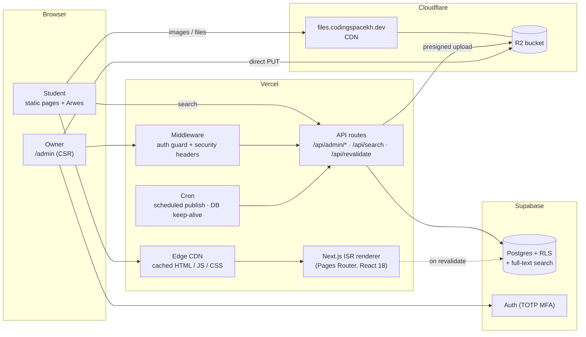
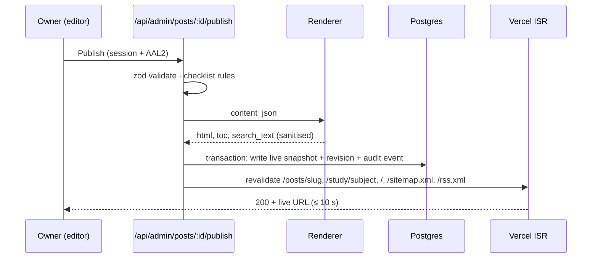
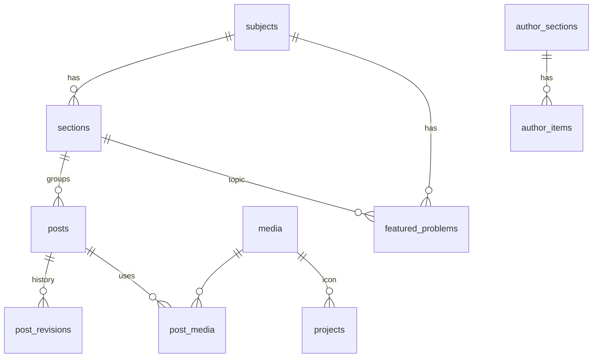

# CodingSpace (codingspacekh.dev) — System Analysis v1.0

| | |
|---|---|
| Status | **Baseline for development.** Replaces `01-system-requirements.md` and `02-system-architecture.md` where they differ. Those two stay as history. |
| Date | 2026-10-15 |
| Owner | Site owner (sole author and admin) |
| Companion | [04-milestones.md](./04-milestones.md): build order and test plan per milestone |
| Prototype | https://claude.ai/artifact/77WHeuCVVA2VWWssueXeDC (layout and workflow reference; not built with Arwes) |

---

## 1. Context

### 1.1 Problem
The owner teaches competition mathematics, physics, programming and Cambridge AS & A Level CS (9618) and IT (9626). Lesson notes, worked problems and course tools are spread across files and chat groups. Students need **one place** to review lessons at any time, on any device, with no login.

### 1.2 Goals
| # | Goal | Measured by |
|---|---|---|
| G1 | Students can find and read any lesson quickly, including on a phone on 4G. | LCP < 2.5 s at p75; lesson ≤ 2 clicks from Home |
| G2 | The owner can write and publish a lesson with maths, code, images and files in one sitting, without touching code. | Publish flow ≤ 5 actions after writing |
| G3 | The site is secure: only the owner can change content. | 0 open High/Critical findings at launch; MFA enforced |
| G4 | It handles **at least 1,000 visits per day**, with 10× headroom. | k6 test: 20 HTML req/s for 10 min, p95 < 300 ms, 0 errors |
| G5 | The UI is a distinctive sci-fi experience (Arwes) that never gets in the way of reading. | Reading works with motion off; Lighthouse a11y ≥ 95 |
| G6 | Built test-first (TDD) and cheap to run. | Every feature lands with tests written first; < USD 10/month at launch |

### 1.3 Stakeholders and actors
| Actor | Needs | Auth |
|---|---|---|
| **Student** (main audience; many are minors; mostly phones) | Read lessons, try problems, download worksheets, open project sites | None |
| **Owner / Admin** (one person) | Write, publish and organise content; manage projects and profile | Email + password + TOTP (2FA) |
| **Scheduler** (system) | Publish scheduled posts, keep the database awake, run backups | Service credentials |

### 1.4 Scope
**In v1:** public site (Home, Study × 4 subjects, lesson pages, Projects, Author, search, RSS/sitemap); admin (sign-in, dashboard, posts, block editor, media, problem of the week, study structure, projects, profile).

**Out of v1:** comments and questions (designed, deferred to v1.1); student accounts; hosting software installers (projects link to their own landing pages); translations (a post is either English or Khmer); payments.

---

## 2. Decision log (consolidated)

| # | Decision | Reason |
|---|---|---|
| D1 | **Next.js 16.4 Pages Router, built with webpack (`next build --webpack`) + React 18.3**, `reactStrictMode: false`; React 19 compatibility tested in CI | Arwes declares React 18 and doesn't support StrictMode or Server Components. Turbopack adds inline scripts that break a strict static CSP. Next 17 will drop React 18, and Arwes passed all spike tests on React 19 ([ADR 0001](./adr/0001-arwes.md)). |
| D2 | **Arwes isolated in `src/ui/arwes/`**, pinned to `1.0.0-next.25020502`, with the safe-math patch replacing its `eval` | Arwes is no longer maintained; contain the risk and keep CSP free of `'unsafe-eval'` ([ADR 0001](./adr/0001-arwes.md)). |
| D3 | **Static pages + on-demand revalidation (ISR)** for every public page | Fast, cheap, survives database hiccups; scales far past 1,000 visits/day. |
| D4 | **Supabase** (Postgres, Auth, RLS) | Managed Postgres with auth and row-level security on a free tier. |
| D5 | **Cloudflare R2** for media and lesson files, served from `files.codingspacekh.dev` | No egress fees. The capacity analysis in §5 shows image traffic would exceed Supabase Storage's free egress. *This reverses the v0.2 note that suggested Supabase Storage.* |
| D6 | **Tiptap** editor; content stored as JSON and compiled to HTML **at publish time** (KaTeX + Shiki + sanitiser) | Public pages ship no editor, maths or highlighter JavaScript. |
| D7 | Menu: **Home · Study ▾ (Math, Physics, Coding, IT) · Projects · Author** | Owner's redesign. Math = competition topics. |
| D8 | **No comments in v1** | Owner decision; removes the biggest abuse surface. |
| D9 | **Domain `codingspacekh.dev`, brand "CodingSpace"** | Owner decision (2026-10-17: `codingspacekh.dev` instead of the planned `codingspace.io`). |
| D10 | **TDD** is the core process (§10) | Owner preference; also the main quality and security safety net for a solo developer. |
| D11 | **Vercel** hosting (Hobby to start) | First-class Next.js ISR and CDN. *M3: on Hobby, Vercel Cron runs only once a day, so the 5-minute scheduled-publish timer is a GitHub Actions workflow calling `/api/cron/publish-due` with a secret.* |

---

## 3. Functional requirements

Priority: **M** must (v1), **S** should (v1 if time allows), **C** could (later). Each ID is used for traceability in the milestones.

### 3.1 Public site
| ID | Requirement | P |
|---|---|---|
| PUB-01 | Home: hero ("Prove it. Model it. Code it."), the four Study tracks, Problem of the week, latest 3 lessons, featured projects, author teaser. | M |
| PUB-02 | Top menu Home · Study ▾ · Projects · Author. Study opens a menu of the subjects (4 at launch; the owner can add more, v1.1) (keyboard and touch accessible). | M |
| PUB-03 | Subject page: intro, section shortcuts, lessons **grouped by section** in the owner's order, each card showing level, minutes and problem count. | M |
| PUB-04 | Lesson page: breadcrumb, tags, title, meta, rendered body (headings, lists, quotes, links, **maths**, **highlighted code with copy**, callouts, images with captions, file downloads, embeds), prev/next within section, section side-nav, table of contents. | M |
| PUB-05 | Math page and Home show the **Problem of the week** with reveal-on-click hint and solution. | M |
| PUB-06 | Projects page: cards linking to each project's **external landing page**; one featured project first. | M |
| PUB-07 | Author page: profile, stats, timeline, **life posts**, contact email as copyable text. | M |
| PUB-08 | Khmer posts render with a Khmer font and `lang="km"`. | M |
| PUB-09 | Full-text search across published posts. | S |
| PUB-10 | RSS feed, `sitemap.xml`, OpenGraph cards, structured data (`Article`). | M |
| PUB-11 | Sound toggle (off by default), motion toggle (follows OS reduced-motion), **reading mode**, print stylesheet. | M |
| PUB-12 | Custom 404 / 500 pages in the site style. | M |

### 3.2 Admin
| ID | Requirement | P |
|---|---|---|
| ADM-01 | Sign in with email + password, then **TOTP 2FA** (required). One allowed owner account. Sign out; session expires after 12 h idle (enforced by the app: Supabase's own session timeout needs the Pro plan). | M |
| ADM-02 | Dashboard: counts (published, drafts, scheduled, life), recent posts, quick actions. | M |
| ADM-03 | Posts list: search; filter by type, subject and status; edit, view, delete with confirmation. | M |
| ADM-04 | Block editor: headings, bold/italic/underline/strike, links, lists, quotes, **"/" menu**, maths block with live preview and inline maths, code block with language, callout (Note / Contest tip / Exam tip / Warning), image (upload, paste, drag), file attachment, embed (YouTube, Desmos, GeoGebra), divider, undo/redo. | M |
| ADM-05 | Lesson settings: subject → section (dependent list), level, minutes, problems, language, summary; read-only URL preview. | M |
| ADM-06 | **Autosave** (≤ 1 s debounce) and a revision history with restore. | M |
| ADM-07 | **"Ready to publish?" checklist**: title, body, section required; summary and image alt text recommended. | M |
| ADM-08 | **Preview** exactly as students see it, behind auth. | M |
| ADM-09 | **Publish / Update / Unpublish / Schedule.** A published post keeps a live snapshot; edits show "Unpublished changes" until Update. Publishing regenerates the affected pages within 10 s. | M |
| ADM-10 | Media library: browse, search, reuse, delete unused files; images auto-resized to WebP/AVIF; metadata (EXIF/GPS) stripped. | M |
| ADM-11 | Problem of the week editor with live maths preview and week date. | M |
| ADM-12a | Subjects (v1.1, owner request 2026-10-18): add, edit (name, symbol, colour, menu line, introduction), show or hide, reorder and delete subjects. A new subject starts hidden; a hidden subject and everything in it (sections, lessons, problem of the week) never reach visitors. Only an empty subject can be deleted. | S |
| ADM-12 | Study structure: add, rename, describe, reorder and delete sections (deleting one deletes its lessons, after a confirmation that lists them; owner change 2026-10-17); reorder lessons inside a section. | M |
| ADM-13 | Projects: create, edit, delete; one featured; landing URL validated (https only). | M |
| ADM-14 | Author page: photo, name, bio (Markdown), stats, public email, and sections in the owner's order: timeline, experience, education, skills, awards & certificates, hobbies & interests, life posts and any number of custom sections. Every part except the name can be hidden, down to single items; hidden parts never reach visitors (owner request 2026-10-17). | M |
| ADM-15 | Admin audit log (who did what, when) visible on the dashboard. | S |
| ADM-16 | Export all content to Markdown + JSON (backup and portability). | S |

---

## 4. Non-functional requirements

| ID | Area | Requirement | How it is verified |
|---|---|---|---|
| NFR-PERF-1 | Speed | **Real users:** LCP < 2.5 s, INP < 200 ms, CLS < 0.1 at p75 on mid-range Android over 4G. **Lab gate:** Lighthouse mobile Performance ≥ 75, TBT ≤ 1,000 ms, A11y/SEO/Best practices ≥ 95 | Vercel Speed Insights in production; Lighthouse CI on every PR (gate calibrated in [ADR 0001](./adr/0001-arwes.md)) |
| NFR-PERF-2 | Weight | First-load JS ≤ 200 KB gzipped on lesson pages; ≤ 260 KB on Home (orbit hero) | `next build` output checked in CI (bundle budget test) |
| NFR-PERF-3 | Server | Cached HTML TTFB < 200 ms; uncached (revalidating) < 800 ms | k6 + synthetic monitor |
| NFR-CAP-1 | Capacity | ≥ 1,000 visits/day; tested at **10×** (20 HTML req/s for 10 min, p95 < 300 ms, 0 % errors) | k6 load test before launch (M7) |
| NFR-SEC-1 | Security | OWASP ASVS **Level 1** fully, plus L2 for authentication and session controls | Security checklist + automated tests (§8.4) |
| NFR-SEC-2 | Security | Security headers grade **A** (CSP, HSTS, etc.) | Header tests in CI; OWASP ZAP baseline scan |
| NFR-PRIV-1 | Privacy | No visitor accounts, no tracking cookies, cookie-less analytics, EXIF stripped from images | Tests + review |
| NFR-A11Y-1 | Accessibility | WCAG 2.1 AA; full keyboard use; honours `prefers-reduced-motion` | axe checks in Playwright; manual keyboard pass per milestone |
| NFR-SEO-1 | SEO | Static semantic HTML, sitemap, canonical URLs, OpenGraph | Lighthouse SEO ≥ 95 |
| NFR-REL-1 | Reliability | 99.5 % monthly; public pages keep serving if the database is down | Chaos test: block DB in staging, pages still load |
| NFR-REL-2 | Backups | Daily DB backup; weekly export to R2; **restore drill** before launch | Documented drill in M7 |
| NFR-MAINT-1 | Quality | TypeScript strict; lint clean; coverage ≥ 90 % for `src/server` and `src/lib`, ≥ 70 % overall | CI gate |
| NFR-COST-1 | Cost | < USD 10/month at launch traffic (domain excluded) | Monthly review |

---

## 5. Capacity analysis (why 1,000 visits/day is comfortable)

**Assumptions:** 1,000 visits/day × 3 pages/visit = **3,000 page views/day**. Traffic is bursty (before class or exams): assume 25 % of a day's views in one hour, and short spikes 10× that.

| Quantity | Value |
|---|---|
| Average HTML rate | 3,000 / 86,400 ≈ **0.035 req/s** |
| Busy hour | 750 views/h ≈ **0.21 req/s** |
| Spike | ≈ **2 req/s** |
| **Design target (10× spike)** | **20 HTML req/s** sustained |
| Database reads per page view | **≈ 0.** Pages are pre-rendered; the DB is read only on publish/revalidate, search and admin. |
| Bandwidth (≈ 0.4 MB average per view after caching) | ≈ 1.2 GB/day ≈ **36 GB/month** |

**Consequences:**
1. **HTML is served from the CDN**, so 20 req/s is far below what Vercel's edge handles. The bottleneck is never compute.
2. **Images and files dominate bandwidth.** That is why media lives on **R2 (no egress fees)** behind Cloudflare's CDN, not on Supabase Storage (5 GB/month free egress) or Vercel Image Optimization (limited free transformations). Variants are generated **once, at upload**.
3. **Search** is the only public path that touches the database: cache results at the CDN for 5 min per query and rate-limit to 30 requests/min per IP.
4. **Free-tier caveats:** Supabase free projects **pause after 7 days without activity.** Because pages are static, the DB may see little traffic, so a daily cron query keeps it awake. Upgrade to Supabase Pro (≈ USD 25/month) if pausing ever bites. Vercel Hobby is for non-commercial use, which suits a personal teaching site; move to Pro if that changes.

---

## 6. Architecture

### 6.1 Components
| Component | Responsibility | Notes |
|---|---|---|
| **Public pages** (`/`, `/study/[subject]`, `/posts/[slug]`, `/projects`, `/author`) | Render content as static HTML | `getStaticProps` + `revalidate: false`; refreshed **on demand** at publish |
| **Admin app** (`/admin/**`) | Authoring UI | Client-rendered, `noindex`, guarded by middleware **and** server checks |
| **Admin API** (`/api/admin/*`) | All writes: posts, sections, POTW, projects, profile, uploads, publish | Validates input with **zod**; checks session, AAL2 and owner ID |
| **Renderer** (`src/server/render`) | Tiptap JSON → safe HTML (KaTeX, Shiki, allow-list sanitiser), TOC, reading time, search text | Pure functions, the most heavily tested module |
| **Revalidation** | After publish: rebuild post, its subject page, Home, Author/Projects as needed, sitemap, RSS | `res.revalidate()` on an explicit list of paths |
| **Cron** | Every 5 min: publish due scheduled posts. Daily: DB keep-alive, export backup to R2 | Protected by `CRON_SECRET` |
| **UI layer** (`src/ui`) | Design tokens + Arwes wrappers (`Frame`, `SciButton`, `DecipherText`, `Backdrop`, `BleepsRoot`) | The only place that imports `@arwes/*` |

### 6.2 Rendering rules for speed and readability
1. Lesson body HTML is **never hidden behind an Arwes animator**; it is visible in the first paint.
2. Arwes animates only the page chrome (frames, headings, nav, background).
3. The orbit hero and background effects are loaded lazily on the client and pause when the tab is hidden or motion is off.
4. Sounds load only after the visitor turns sound on.
5. Fonts are self-hosted with `next/font` (no Google requests, no layout shift), with Khmer subsetting.
6. KaTeX CSS and fonts load only on pages that contain maths.

### 6.3 Publish flow

---

## 7. Data model

| Table | Key columns |
|---|---|
| `subjects` | `id` (the address in `/study/<id>`, letters only, fixed once made), `name`, `glyph`, `color` (palette in `src/lib/subjects.ts`), `blurb`, `intro`, `visible`, `sort` — four seeded (`math`/`physics`/`coding`/`it`), more added in `/admin/subjects` (v1.1) |
| `sections` | `id`, `subject_id`, `slug`, `title`, `description`, `sort` · unique (`subject_id`, `slug`) |
| `posts` | `id`, `kind` (`lesson`/`life`), `slug` (unique), `subject_id?`, `section_id?`, `sort`, `level` (1–3), `minutes`, `problem_count`, `lang` (`en`/`km`), **draft fields**: `title`, `summary`, `content_json`; **live fields**: `live_title`, `live_summary`, `live_html`, `live_toc`, `live_search_text`, `live_search` (generated tsvector, `simple` config, GIN index), `live_has_math`, `live_has_code`, `live_updated_at`, `status` (`draft`/`scheduled`/`published`), `scheduled_at`, `published_at`, `updated_at`, `revision` |
| `post_revisions` | `id`, `post_id`, `content_json`, `title`, `created_at` (kept: last 50 per post) |
| `media` | `id`, `r2_key`, `kind` (`image`/`file`), `mime`, `bytes`, `sha256`, `width`, `height`, `variants` (jsonb), `alt`, `original_name`, `created_at` |
| `post_media` | `post_id`, `media_id` (for "unused media" detection) |
| `featured_problems` | `id`, `subject_id`, `section_id`, `week_of`, `statement`, `hint`, `solution` (LaTeX-flavoured text), `is_current` |
| `projects` | `id`, `name`, `glyph`, `subject_id`, `tag`, `description`, `platforms`, `landing_url` (https only), `is_featured` (partial unique index: only one true), `sort` |
| `profile` | single row: `name`, `bio` (Markdown), `years`, `students`, `email`, photo (`photo_media_id` + copied sizes), `hidden` (header parts not shown) |
| `author_sections` / `author_items` | the Author page's sections in order (`kind`, `title`, `visible`, `sort`; a built-in section's id is its kind) and their items (`title`, `subtitle`, `period`, `note` (Markdown), `url`, `tags`, `visible`, `sort`) |
| `audit_events` | `id`, `actor`, `action`, `entity`, `entity_id`, `at`, `meta` |

**Row-level security**
- `anon`: `SELECT` only. Pages read through `security_invoker` views that expose **published live fields** (`public_posts`, `public_sections`, `public_projects`, `public_featured_problems`); RLS and column grants on the tables still apply underneath. The Author page is read only through `author_page()` (security definer), which leaves out every part the owner hid; anon can't read `profile` or the section tables. No access to drafts, past featured problems, media metadata or audit data.
- Writes go **only** through admin API routes using a server-side client. Policies also require `auth.uid() = OWNER_ID` **and** `auth.jwt()->>'aal' = 'aal2'`, so even a leaked anon key or a non-MFA session can't write.

---

## 8. Security architecture

### 8.1 Assets
1. Integrity of published content (students trust it).
2. The owner's account and session.
3. Availability of lessons near exams.
4. Students' privacy (no accounts, but IPs and devices still matter).

### 8.2 Threat model (STRIDE, abridged)
| Threat | Example | Controls | Verified by |
|---|---|---|---|
| **Spoofing** | Password guessing or phishing of the admin | TOTP 2FA required (AAL2); Supabase auth rate limits; Turnstile on the login form; no account sign-up; owner ID allow-list | Integration tests: login without MFA cannot reach admin or write; sign-up disabled |
| **Tampering** | Writes through the public anon key or forged API calls | RLS denies all anon writes; API checks session + AAL2 + owner; zod validation; `SameSite=Lax` HttpOnly cookies and an Origin check on mutating routes (CSRF) | **pgTAP RLS tests**; API tests for 401/403 on every admin route |
| **Repudiation** | "Who deleted that lesson?" | `audit_events` written in the same transaction as each change | Test: every mutating route writes one audit row |
| **Information disclosure** | Drafts leaking before publish; secrets in the client bundle | Public views expose live fields only; preview requires auth; secrets only in server env; bundle scan for secret patterns in CI | Tests: anon cannot read drafts; CI grep of the `.next` client output |
| **Denial of service** | Search hammering, huge uploads | CDN-cached pages; search rate limit + CDN cache; upload size limits enforced by the presigned URL and server checks | k6 test; unit tests for limits |
| **Elevation / XSS** | Script injected through content, an SVG upload or an embed URL | Renderer emits only allow-listed nodes; links limited to `https:`/`mailto:`; images only from `files.codingspacekh.dev`; embeds only from allow-listed hosts (`youtube-nocookie.com`, `desmos.com`, `geogebra.org`); **SVG uploads rejected**; strict CSP | **XSS payload corpus test** against the renderer; CSP header test; ZAP baseline |

### 8.3 Controls checklist
- **Headers** (set in middleware/`next.config.js`):
  - `Content-Security-Policy` (tested in M0): `default-src 'self'; script-src 'self'; style-src 'self'; style-src-attr 'unsafe-inline'; img-src 'self' https://files.codingspacekh.dev data:; font-src 'self'; connect-src 'self' https://<project>.supabase.co; frame-src https://www.youtube-nocookie.com https://www.desmos.com https://www.geogebra.org; frame-ancestors 'none'; base-uri 'self'; form-action 'self'; object-src 'none'`. The only relaxation is `style-src-attr 'unsafe-inline'`, for `style=""` attributes from KaTeX, Shiki and Arwes, which can't execute code.
  - `Strict-Transport-Security: max-age=63072000; includeSubDomains; preload`
  - `X-Content-Type-Options: nosniff`
  - `Referrer-Policy: strict-origin-when-cross-origin`
  - `Permissions-Policy: camera=(), microphone=(), geolocation=()`
- **Uploads:**
  - Presigned PUT valid for 10 min, with content-type and length conditions.
  - Server verifies magic bytes after upload. Images are re-encoded with `sharp`, which strips metadata.
  - Documents are served with `Content-Disposition: attachment` from the separate `files.` domain (cookie isolation).
  - Allowed types: jpg, png, webp, gif, pdf, docx, pptx, xlsx, zip, txt, py, sql. Maximum size: 100 MB.
- **Dependencies:**
  - Lockfile committed; `npm audit --audit-level=high` in CI; Renovate weekly.
  - React and Arwes are pinned and upgraded only through an ADR.
- **Secrets:**
  - Stored in Vercel env vars per environment; never `NEXT_PUBLIC_*` except the Supabase URL and anon key.
  - Rotated on a schedule documented in the runbook.
- **Admin hygiene:**
  - TOTP recovery codes stored offline.
  - Session idle timeout 12 h.
  - "Sign out everywhere" button.
- **Backups:** daily Supabase backup plus a weekly JSON/Markdown export to a versioned R2 bucket, with a restore drill before launch.

### 8.4 Security tests (part of TDD, run in CI)
1. RLS: anon cannot `INSERT`/`UPDATE`/`DELETE` any table, and cannot `SELECT` drafts (pgTAP).
2. API: every `/api/admin/*` route returns 401 without a session and 403 with an AAL1 session or a non-owner user.
3. Renderer: an XSS corpus (script tags, `javascript:` URLs, event handlers, SVG payloads, CSS injection) produces no executable output.
4. Uploads: rejects wrong magic bytes, oversized files and SVG.
5. Headers: CSP/HSTS/etc. present on HTML responses.
6. ZAP baseline scan against the preview deployment: 0 high-severity alerts.

---

## 9. Performance architecture
| Layer | Technique |
|---|---|
| HTML | Static generation + on-demand ISR; `Cache-Control: s-maxage=31536000, stale-while-revalidate` |
| JS | Admin code split from public bundles; Arwes only on pages that animate, sound loaded on first use, CSS backdrop, orbit loaded with `next/dynamic` (ADR 0001 addendum); no editor, KaTeX or Shiki JS on public pages |
| CSS | Token-based CSS modules; KaTeX CSS only on pages with maths |
| Fonts | `next/font` self-hosted, `display: swap`, subsets (Latin + Khmer) |
| Images | Variants at upload (480/960/1600, WebP + AVIF), `srcset`, explicit width/height, lazy below the fold |
| Search | Postgres FTS + GIN index; CDN cache 5 min per query; debounce on the client |
| Monitoring | Vercel Speed Insights (real-user Web Vitals), uptime check, Sentry for API errors |

---

## 10. Development process: Test-Driven Development

### 10.1 The loop
Every change follows **Red → Green → Refactor**:
1. **Red:** write a failing test that states the behaviour (from a requirement ID), and run it to see it fail.
2. **Green:** write the smallest code that passes.
3. **Refactor:** clean up with all tests green.
4. Commit with the requirement ID in the message (e.g. `ADM-09: publish writes live snapshot`).

Features start **outside-in**: a Playwright acceptance test for the user journey is written first and stays red. Unit and integration tests drive the pieces until the acceptance test turns green.

### 10.2 Test pyramid and tools
| Level | Tool | What it covers | Speed |
|---|---|---|---|
| Unit | **Vitest** | Renderer, sanitiser, slug, zod schemas, checklist rules, ordering, date/schedule logic, capacity calculations | ms |
| Component | **Vitest + React Testing Library** | Editor blocks, settings panel, menus, toggles. Arwes rendered with the animator **disabled** so tests check behaviour, not animation. | ms |
| Integration | **Vitest + Supabase local (Docker)** | API routes against a real Postgres with RLS; R2 mocked with **MSW** / a MinIO container | seconds |
| Database | **pgTAP** (`supabase test db`) | RLS policies, constraints (one featured project, unique slugs) | seconds |
| End-to-end | **Playwright** (+ `@axe-core/playwright`) | Student journeys and the owner's publish journey; accessibility on key pages; visual snapshots with motion off | minutes |
| Performance | **Lighthouse CI**, bundle budget, **k6** | Web Vitals budgets per PR; load test before launch | minutes |
| Security | pgTAP + API tests + XSS corpus + **OWASP ZAP baseline** | §8.4 | minutes |

### 10.3 CI gates (GitHub Actions, on every pull request)
`typecheck` → `lint` → `unit + component` (coverage thresholds) → `db tests` → `integration` → `build` + bundle budget → deploy preview → `e2e + axe` → `Lighthouse CI` → `ZAP baseline` (nightly and before release). **A red gate blocks the merge.**

### 10.4 Definition of Done (per feature)
- [ ] Acceptance test written first, now green.
- [ ] Unit/integration tests for new logic; coverage thresholds met.
- [ ] Security tests updated if a route, table or input was added.
- [ ] Accessibility check passes; works with motion off and with the keyboard.
- [ ] Lighthouse budgets pass.
- [ ] Requirement ID referenced; docs updated if behaviour changed.

---

## 11. Environments and operations
| Env | Purpose | Data |
|---|---|---|
| Local | Development with Supabase CLI (Docker) and MinIO for R2 | Seed script |
| Preview | One per pull request (Vercel) using a staging Supabase project | Seed + anonymised copy |
| Production | `codingspacekh.dev` | Real |

Runbook items (written in M7): deploy and rollback, restore from backup, rotate secrets, recover a lost 2FA device, what to do if the DB pauses.

---

## 12. Risks
| Risk | Likelihood | Impact | Mitigation |
|---|---|---|---|
| Arwes breaks on a newer browser, or conflicts with Next.js/SSR | Medium | High | **M0 spike first**; isolation layer; fallback is plain CSS frames (the prototype shows this works) |
| Solo owner has limited time (teaching load) | High | Medium | Small milestones, each shippable; content can be seeded before the editor exists |
| Supabase free project pauses | Medium | Medium | Daily keep-alive cron; static pages keep serving anyway |
| Lost 2FA device locks out the owner | Low | High | Offline recovery codes; documented recovery procedure |
| Heavy effects hurt low-end phones | Medium | Medium | Motion/reading modes, lazy effects, performance budgets in CI |
| Bandwidth growth past the free tier | Low | Low | R2 for media; CDN caching; monthly cost review |
