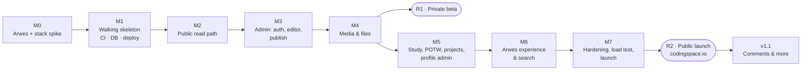

# CodingSpace (codingspace.io) — Milestones & Build Order

Companion to [03-system-analysis.md](./03-system-analysis.md). Requirement IDs (PUB-, ADM-, NFR-) refer to that document. Date: 2026-10-15.

---

## 1. How the order was chosen

1. **Biggest risk first.** Arwes is unmaintained and tied to React 18, so if it fails, much of the plan changes. A short spike (M0) settles this before anything else depends on it.
2. **Testing pipeline before features.** TDD needs working tests, CI and preview deploys on day one (M1). Every later milestone adds tests to that pipeline.
3. **Students' value early.** The read path (M2) is built before the editor. It also fixes the **content format** (Tiptap JSON → HTML) that the editor must produce, so the editor is built against a tested contract.
4. **Shippable steps.** After M4 the owner can write real lessons in a private beta. After M7 the site launches publicly at `codingspace.io`.
5. **Polish late, but not last.** Arwes styling (frames, theme, tokens) arrives in M1–M2 so every page looks right from the start. The expensive effects (orbit hero, sound design) come in M6, once content and workflow are stable.

## 2. Summary

| # | Milestone | Main outcome | Requirements | Effort* |
|---|---|---|---|---|
| **M0** | Arwes & stack spike | Go/no-go on Arwes inside Next.js Pages Router; CSP and performance numbers measured | D1, D2, NFR-PERF-2 | 3 days |
| **M1** | Walking skeleton | Repo, CI gates, Supabase local + RLS baseline, security headers, preview deploys, first green E2E | NFR-SEC-2, NFR-MAINT-1 | 4 days |
| **M2** | Public read path | Home, Study ×4, lesson, Projects, Author pages from the DB; renderer; SEO; content import script | PUB-01…08, 10, 12 | 8 days |
| **M3** | Admin core | 2FA sign-in, dashboard, posts list, block editor, autosave, revisions, checklist, preview, publish/update/schedule | ADM-01…09 | 10 days |
| **M4** | Media & files | R2 uploads, image variants, EXIF strip, attachments, media library | ADM-10 | 5 days |
| — | **R1: private beta** | Production deploy on a `*.vercel.app` URL, `noindex`; owner writes real lessons; 3–5 students try it | | |
| **M5** | Site-content admin | Problem of the week, study structure, projects, profile editors | ADM-11…14, PUB-05…07 | 5 days |
| **M6** | Arwes experience & search | Orbit hero, decipher text, sound design, backdrop, motion/reading modes, print, search | PUB-09, PUB-11, NFR-A11Y-1 | 6 days |
| **M7** | Hardening & launch | Security review (ASVS L1), ZAP, k6 load test, backup restore drill, audit log, export, runbook, domain | NFR-CAP-1, NFR-SEC-1, NFR-REL-2, ADM-15, ADM-16 | 5 days |
| — | **R2: public launch** | `codingspace.io` live and indexed | | |

\* *Effort = focused working days for one developer, including tests. Total ≈ **46 focused days**. At 2–3 focused days a week alongside teaching, that is roughly **4–5 months** of calendar time. Treat the estimates as planning ranges (±30 %), not promises.*

---

## 3. Milestones in detail

Each milestone lists the **tests written first**. They start red and define "done".

### M0 — Arwes & stack spike (3 days) — ✅ DONE 2026-10-15: **GO** ([ADR 0001](./adr/0001-arwes.md))
**Goal:** prove the risky stack works together before investing in it.

**Build (throwaway branch):**
- Next.js Pages Router, React 18.3, `reactStrictMode: false`, `@arwes/react` pinned.
- One page with: an Arwes `FrameSVG` card, the decipher `Text` effect, `Animator` enter sequence, `BleepsProvider` with a click sound, and a `GridLines`/`Dots` backdrop.
- One static "lesson" with KaTeX-rendered maths and Shiki code, to measure page weight.

**Tests first:**
- Playwright: the page renders server-side with readable text **before JS runs** (JS disabled).
- Playwright: no console errors or hydration warnings.
- Bundle budget: first-load JS measured and recorded against NFR-PERF-2.
- Header test: the strict CSP from 03 §8.3 is applied and the page still works. Record whether Arwes needs `style-src 'unsafe-inline'`.

**Exit criteria:** an ADR (`docs/adr/0001-arwes.md`) recording **go** or **fallback** (fallback: plain CSS frames as in the prototype), with measured bundle size, Lighthouse score and CSP findings.

### M1 — Walking skeleton (4 days) — ✅ DONE 2026-10-15
> **Result:**
> - Repo `codingspacekh/codingspace` (public). `main` is protected: PRs only, 3 required checks, enforced for admins too.
> - CI on every PR: audit, types, lint, format, coverage, pgTAP, E2E + axe; React 19 compatibility job (informational).
> - Supabase **codingspace-staging** (Singapore): migration applied; 24/24 RLS tests pass on the live DB; sign-up disabled (verified); TOTP on.
> - Vercel project `codingspace` connected to GitHub: protected PR previews; production at `codingspace-tawny.vercel.app` (noindex until M7).
> - Deviations: `eslint-config-next` dropped (unfixable `braces` advisory). Supabase's session timeout is Pro-only, so the 12 h idle timeout moves into the app (M3). Local Docker (Colima) is still installing; database tests run in CI meanwhile.
**Goal:** every later change runs through a working TDD pipeline.

**Build:**
- Repo layout from the architecture doc; TypeScript strict; ESLint/Prettier.
- Vitest, RTL, Playwright, pgTAP, MSW set up.
- GitHub Actions with all gates from 03 §10.3 (Lighthouse and ZAP can start as non-blocking).
- Supabase CLI local stack; first migrations: `subjects` (seeded), `sections`, `posts`, `audit_events`; **RLS deny-by-default**.
- Middleware with security headers.
- Vercel project with preview deploys and a staging Supabase project.
- `src/ui` token theme and a base Arwes `Frame` wrapper, using the M0 result.

**Tests first:**
- pgTAP: anon cannot write any table; anon cannot read draft rows.
- Header test: CSP, HSTS, nosniff, Referrer-Policy and Permissions-Policy present.
- Playwright: home placeholder loads on the preview URL and passes axe.

**Exit criteria:** a pull request with a failing test cannot merge; a passing one deploys a preview automatically.

### M2 — Public read path (8 days) — ✅ DONE 2026-10-16 (placeholder content)
> **Result:**
> - **Renderer** (`src/server/render`): Tiptap JSON → allow-listed HTML with KaTeX, Shiki, callouts, tables, figures, files and checked embeds; TOC, search text, reading time. XSS corpus of ~60 payloads, Khmer round-trip, 3 reference-lesson snapshots.
> - **Read schema:** lesson metadata, projects, profile, timeline, featured problems; six `security_invoker` `public_*` views; 44 more pgTAP tests.
> - **Content import** (`npm run content:import`): Markdown → editor JSON → database, validated with file and line in every error; integration-tested against a local Supabase in CI.
> - **Pages from the database:** Home, `/study/[subject]`, `/posts/[slug]` (TOC, prev/next, section side-nav, code copy), Projects, Author, 404/500; Study ▾ menu; Khmer font for `lang="km"`; static with 5-minute ISR.
> - **SEO:** canonical URLs, OpenGraph, `Article` JSON-LD, `sitemap.xml`, `rss.xml`, `robots.txt` (blocked until launch, like the `noindex` header).
> - **Budgets:** new CI job `Lighthouse (lab budgets)` on every PR. On the CI runner: Performance 0.96–0.98, TBT 15–35 ms, LCP 2.3–2.7 s, Accessibility/SEO/Best practices 1.0.
> - **Deviations:**
>   - Content is **placeholder** (owner's choice): 9 lessons and 2 life posts marked `dummy: true`. The exit criterion "at least 5 real lessons" is open until real lessons replace them.
>   - The animated Arwes backdrop became the prototype's CSS grid, and Arwes now loads only on pages that animate (ADR 0001 addendum). Animated effects return in M6 under the same budget.
>   - `@lhci/cli` lives in `tools/lighthouse/` with its own lockfile (its puppeteer helpers carry advisories with no fix).
>   - `og:image` is deferred to M6, with the final visual design.

**Goal:** students can browse real content (seeded) with the final page structure.

**Build:**
- Remaining read-side schema and public views (`public_posts`, `public_sections`, `projects`, `profile`, `featured_problems`).
- **Renderer:** Tiptap JSON → sanitised HTML with KaTeX, Shiki, callouts, figures, file rows and embeds; TOC; reading time; search text.
- Pages:
  - Home: static hero version for now; the orbit comes in M6.
  - `/study/[subject]` with sections.
  - `/posts/[slug]` with prev/next and side-nav.
  - `/projects`, `/author`, and the 404/500 pages.
- Top menu with the Study dropdown, sound/motion toggle stubs, Khmer font for `lang=km`.
- SEO: meta tags, OpenGraph, `sitemap.xml`, `rss.xml`, `Article` structured data.
- **Content import script:** Markdown (with `$…$` maths and fenced code) → the same JSON the editor will produce, so real lessons can be loaded before M3.

**Tests first:**
- Renderer unit tests per node type, plus the **XSS corpus** (must output nothing executable), link/embed/image allow-lists, and a Khmer text round-trip.
- Snapshot tests of rendered HTML for 3 reference lessons (maths, code, mixed).
- Playwright: Home → Study ▾ → Math → Inequalities → lesson → Next lesson; Author shows life posts; project card opens the external URL in a new tab.
- Lighthouse CI on lesson and subject pages meets NFR-PERF-1 and SEO ≥ 95.

**Exit criteria:** all public pages render from the DB on preview; budgets pass; content import works for at least 5 real lessons.

### M3 — Admin core (10 days) — 🚧 in progress (started 2026-10-16)
> **Plan (one PR each):**
> 1. ✅ **Sign-in & admin gate:** password + required TOTP, HttpOnly session cookies through our own API (the browser never calls Supabase), proxy + `withOwner()` + RLS, 12 h idle timeout and revocation in `public.admin_touch()`, sign out (everywhere), Origin check on every mutating route.
> 2. ✅ **Write side:** every edit stays in the draft until Publish/Update, settings included (new `live_*` columns); one `admin_*` function per change (create, save, publish, unpublish, schedule, restore, delete), each with its revision and audit row; stale saves get 409; the URL is locked after the first publish; `src/server/admin/posts.ts` renders on publish and returns the pages to revalidate.
> 3. ✅ **Dashboard and posts list** (ADM-02, ADM-03): counts linking to the filtered list, recent edits, New lesson / New life post; search and filters kept in the address bar; delete with an inline confirmation, rebuilding the post's pages if it was live.
> 4. ✅ **Editor and settings panel** (ADM-04, ADM-05): Tiptap 3 with exactly the content format's nodes (a round-trip test loads every fixture and imported lesson and expects identical JSON and HTML); toolbar and "/" menu with keyboard navigation; maths blocks and inline maths with a live KaTeX preview using the renderer's own options; code language, callout type, embeds from a pasted link; existing images and files kept (uploads in M4); settings with the dependent Section list; the URL follows the title until first publish. Save by button or Ctrl/⌘+S; a stale tab gets a conflict instead of overwriting.
> 5. ✅ **Autosave and history** (ADM-06): saves a second after the last edit, one request at a time; retries a lost connection (2 s → 30 s); stops and says so when signed out (12 h idle) or when another tab saved first; saves when the tab is hidden. History panel: preview any kept version as students would see it, restore it after confirming; a restore first keeps the current draft (`before_restore`), so it can be undone.
> 6. ✅ **Publishing** (ADM-07…09): "Ready to publish?" checklist (required items block, recommended ones warn); Preview in a new tab with the real lesson view; Publish / Update / Unpublish (confirmed) / Schedule / Cancel; each rebuilds the affected pages at once (measured < 10 s in the acceptance test); scheduled posts go live through `/api/cron/publish-due`, called every 5 minutes by GitHub Actions.
> - ✅ **Brought forward from M5 at the owner's request: Study structure (ADM-12).** A Study structure page per subject: add, rename and describe sections (the address stays), move them up and down, delete empty ones, and order the lessons inside each; plus "New section…" in the editor's Section menu. Every change rebuilds the subject page and the affected lesson pages.
> 7. Acceptance journey and docs.
>
> **Decisions:** autosave keeps one revision (and one audit row) per 10 minutes of editing, not one per keystroke; a post's URL can't change once published (no redirects yet); `npm run content:import` overwrites drafts, so stop using it for a post once you edit that post in the admin.
>
> **Deviations so far:** the 5-minute timer runs on GitHub Actions, not Vercel Cron: on the Hobby plan Vercel Cron runs only once a day. GitHub can start a scheduled run a few minutes late, so a scheduled post goes live within about 5–15 minutes of its time. Turnstile on the sign-in form (03 §8.2) is not in this milestone's build list; it moves to M7 hardening. Supabase's own auth rate limits apply meanwhile.

**Goal:** the owner can write, preview and publish without touching code.

**Build:**
- Supabase Auth email/password + **required TOTP**; owner allow-list; sign-up disabled; middleware guard for `/admin` and `/api/admin`; 12 h idle timeout; sign out everywhere.
- Dashboard (ADM-02).
- Posts list with filters and delete confirmation (ADM-03).
- Tiptap editor with all block types except real uploads, which come in M4:
  - toolbar and "/" menu
  - maths block with live KaTeX preview, and inline maths
  - code block with language
  - callout, embed, divider
- Settings panel (ADM-05): subject → section, level, minutes, problems, language, summary.
- Autosave + revisions (ADM-06).
- Publish checklist (ADM-07).
- Preview (ADM-08).
- **Publish / Update / Unpublish / Schedule** with live snapshot, revalidation and cron (ADM-09).
- Audit events written for every mutation.

**Tests first:**
- API: every admin route returns **401** without a session and **403** with AAL1 or a non-owner account.
- Unit: publish rules (required fields), snapshot logic ("Unpublished changes" appears only when draft ≠ live), schedule due-time logic, slug generation (including Khmer titles → fallback slug).
- Component: "/" menu filtering and keyboard navigation; maths block preview; dependent section dropdown.
- Integration: publish writes live fields, a revision and an audit row in one transaction, then calls revalidate for the expected paths.
- **Acceptance (Playwright):** sign in with TOTP → New lesson → write with maths and code → Preview → Publish → the lesson appears in its section and in Latest lessons within 10 s.

**Exit criteria:** the acceptance journey is green on preview, and the owner has published a test lesson end to end.

### M4 — Media & files (5 days)
**Goal:** lessons can include images and downloadable worksheets.

**Build:**
- R2 bucket + `files.codingspace.io`.
- Presigned upload API.
- Server verification (magic bytes, size) and `sharp` variants (WebP/AVIF at 480/960/1600) with EXIF stripping.
- Editor image block (upload, paste, drag) with caption/alt.
- File attachment block.
- Media library (browse, reuse, delete unused).
- Download links served with `Content-Disposition: attachment`.

**Tests first:**
- Upload: rejects SVG, wrong magic bytes and oversize; accepts allowed types.
- Image pipeline: output has no EXIF/GPS and has the expected variant sizes.
- Media library: "unused" detection via `post_media`; deleting a used file is blocked.
- Playwright: paste an image, add a caption, publish; the image loads from the files domain with `srcset`.

**Exit criteria → R1 private beta:** production deploy on the `vercel.app` URL with `noindex`. The owner writes 10+ real lessons. 3–5 students give feedback.

### M5 — Site-content admin (5 days)
**Goal:** everything students see can be managed from the admin.

**Build:**
- Problem of the week editor with live preview (ADM-11).
- ~~Study structure: add, rename, describe, reorder and delete sections; reorder lessons (ADM-12).~~ Done in M3.
- Projects CRUD with one featured project and an https-only URL (ADM-13).
- Author profile and timeline (ADM-14).
- The public pages for these (PUB-05/06/07) read from the DB and revalidate on save.

**Tests first:**
- pgTAP: only one featured project; a section cannot be deleted while it has lessons.
- Unit: reorder logic keeps `sort` values contiguous; URL validator rejects `http:` and `javascript:`.
- Playwright: change the Problem of the week → Home and Math show it; reorder sections → the subject page order changes.

**Exit criteria:** no placeholder content left on the public site.

### M6 — Arwes experience & search (6 days)
**Goal:** the futuristic feel, without hurting speed or readability.

**Build:**
- Orbit hero (canvas, lazy-loaded, paused when hidden or when motion is off).
- Decipher headline; `Animator` page transitions for chrome only.
- Bleeps sound set (lazy-loaded after the visitor enables sound).
- Backdrop.
- Motion, reading and print modes (PUB-11).
- Search page and API with CDN cache and rate limit (PUB-09).

**Tests first:**
- Component: with motion off, no animators run and all text is visible immediately; sound assets are not requested until sound is enabled.
- Playwright: keyboard can open Study ▾ and reach every subject; reduced-motion users see no animation.
- Lighthouse: Home still meets NFR-PERF-1 with the orbit (first-load JS ≤ 260 KB).
- Search: results ranked by title over body; rate limit returns 429; drafts never appear.

**Exit criteria:** a Lighthouse pass on Home and lesson pages, and owner sign-off on the look and sound.

### M7 — Hardening & launch (5 days)
**Goal:** safe to open to every student.

**Build / do:**
- ASVS L1 checklist review.
- ZAP baseline must show 0 high-severity alerts.
- Dependency audit.
- Secrets review and rotation.
- **k6 load test** (NFR-CAP-1: 20 HTML req/s for 10 min, p95 < 300 ms, 0 % errors).
- Chaos test with the DB blocked: pages still serve.
- Daily DB keep-alive cron; weekly export to R2; **restore drill**.
- Audit log view (ADM-15); export to Markdown/JSON (ADM-16).
- Runbook.
- Buy and configure `codingspace.io` and `files.codingspace.io` (DNS, HSTS preload later); remove `noindex`; submit the sitemap.
- Uptime monitor, Sentry, Speed Insights.

**Tests first:**
- k6 script with thresholds (it fails the run if the targets are missed).
- Restore drill script: restore into an empty project, run E2E, compare content counts.
- Header test against the production domain.

**Exit criteria → R2 public launch:** every gate green, the restore drill passed, and the owner holds the 2FA recovery codes offline.

### After launch — v1.1 candidates
- Comments and questions with moderation (designed in `01` §3.3).
- Owner analytics dashboard (cookie-less).
- Lesson series navigation across subjects.
- Offline reading (PWA).

---

## 4. Requirement traceability
| Requirement | Milestone |
|---|---|
| PUB-01 Home | M2 (static hero), M6 (orbit) |
| PUB-02 Menu + Study ▾ | M2 |
| PUB-03 Subject page | M2 |
| PUB-04 Lesson page | M2 (images/files rendering completed in M4) |
| PUB-05 Problem of the week | M2 (seeded), M5 (editable) |
| PUB-06 Projects | M2, M5 |
| PUB-07 Author + life posts | M2, M5 |
| PUB-08 Khmer posts | M2 |
| PUB-09 Search | M6 |
| PUB-10 RSS/sitemap/OG | M2 |
| PUB-11 Sound/motion/reading/print | M2 (stubs), M6 |
| PUB-12 Error pages | M2 |
| ADM-01…09 | M3 |
| ADM-10 Media | M4 |
| ADM-11…14 | M5 |
| ADM-15 Audit log view | M7 (events recorded from M3) |
| ADM-16 Export | M7 |
| NFR-PERF-* | Budgets from M1, verified each milestone |
| NFR-CAP-1 | M7 |
| NFR-SEC-* | M1 baseline, extended every milestone, reviewed in M7 |
| NFR-REL-* | M7 |

## 5. What to start with
**M0, the Arwes spike.** It's small (3 days) and answers the one question that could change the plan. Its first step is test-first: a Playwright test asserting that the spike page renders readable, server-side text with JavaScript disabled.
