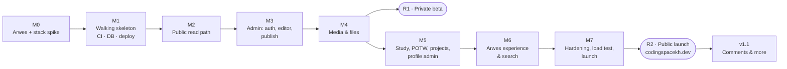

# CodingSpace (codingspacekh.dev) — Milestones & Build Order

Companion to [03-system-analysis.md](./03-system-analysis.md). Requirement IDs (PUB-, ADM-, NFR-) refer to that document. Date: 2026-10-15.

---

## 1. How the order was chosen

1. **Biggest risk first.** Arwes is unmaintained and tied to React 18, so if it fails, much of the plan changes. A short spike (M0) settles this before anything else depends on it.
2. **Testing pipeline before features.** TDD needs working tests, CI and preview deploys on day one (M1). Every later milestone adds tests to that pipeline.
3. **Students' value early.** The read path (M2) is built before the editor. It also fixes the **content format** (Tiptap JSON → HTML) that the editor must produce, so the editor is built against a tested contract.
4. **Shippable steps.** After M4 the owner can write real lessons in a private beta. After M7 the site launches publicly at `codingspacekh.dev`.
5. **Polish late, but not last.** Arwes styling (frames, theme, tokens) arrives in M1–M2 so every page looks right from the start. The expensive effects (orbit hero, sound design) come in M6, once content and workflow are stable.

## 2. Summary

| # | Milestone | Main outcome | Requirements | Effort* |
|---|---|---|---|---|
| **M0** | Arwes & stack spike | Go/no-go on Arwes inside Next.js Pages Router; CSP and performance numbers measured | D1, D2, NFR-PERF-2 | 3 days |
| **M1** | Walking skeleton | Repo, CI gates, Supabase local + RLS baseline, security headers, preview deploys, first green E2E | NFR-SEC-2, NFR-MAINT-1 | 4 days |
| **M2** | Public read path | Home, Study ×4, lesson, Projects, Author pages from the DB; renderer; SEO; content import script | PUB-01…08, 10, 12 | 8 days |
| **M3** ✅ | Admin core | 2FA sign-in, dashboard, posts list, block editor, autosave, revisions, checklist, preview, publish/update/schedule, study structure | ADM-01…09, ADM-12 | 10 days |
| **M4** ✅ | Media & files | R2 uploads, image variants, EXIF strip, attachments, media library | ADM-10 | 5 days |
| — | **R1: private beta** | Production deploy on a `*.vercel.app` URL, `noindex`; owner writes real lessons; 3–5 students try it | | |
| **M5** 🔨 | Site-content admin | Problem of the week, projects, profile editors | ADM-11, 13, 14, PUB-05…07 | 4 days |
| **M6** ✅ | Arwes experience & search | Orbit hero, decipher text, sound design, backdrop, motion/reading modes, print, search | PUB-09, PUB-11, NFR-A11Y-1 | 6 days |
| **M7** | Hardening & launch | Security review (ASVS L1), ZAP, k6 load test, backup restore drill, audit log, export, runbook, domain | NFR-CAP-1, NFR-SEC-1, NFR-REL-2, ADM-15, ADM-16 | 5 days |
| — | **R2: public launch** | `codingspacekh.dev` live and indexed | | |

\* *Effort = focused working days for one developer, including tests. Total ≈ **46 focused days**. At 2–3 focused days a week alongside teaching, that is roughly **4–5 months** of calendar time. Treat the estimates as planning ranges (±30 %), not promises.*

---

## 3. Milestones in detail

Each milestone lists the **tests written first**. They start red and define "done".

### M0 — Arwes & stack spike (3 days) — ✅ DONE 2026-10-15: **GO** ([ADR 0001](./adr/0001-arwes.md))
**Goal:** prove the risky stack works together before investing in it.

**Build (throwaway branch):**
- Next.js Pages Router, React 18.3, `reactStrictMode: false`, `@arwes/react` pinned.
- One page with: an Arwes `FrameSVG` card, the decipher `Text` effect, `Animator` enter sequence, `BleepsProvider` with a click sound, and a `GridLines`/`Dots` backdrop.
- One static "lesson" with KaTeX-rendered maths and Shiki code, to measure page weight.

**Tests first:**
- Playwright: the page renders server-side with readable text **before JS runs** (JS disabled).
- Playwright: no console errors or hydration warnings.
- Bundle budget: first-load JS measured and recorded against NFR-PERF-2.
- Header test: the strict CSP from 03 §8.3 is applied and the page still works. Record whether Arwes needs `style-src 'unsafe-inline'`.

**Exit criteria:** an ADR (`docs/adr/0001-arwes.md`) recording **go** or **fallback** (fallback: plain CSS frames as in the prototype), with measured bundle size, Lighthouse score and CSP findings.

### M1 — Walking skeleton (4 days) — ✅ DONE 2026-10-15
> **Result:**
> - Repo `codingspacekh/codingspace` (public). `main` is protected: PRs only, 3 required checks, enforced for admins too.
> - CI on every PR: audit, types, lint, format, coverage, pgTAP, E2E + axe; React 19 compatibility job (informational).
> - Supabase **codingspace-staging** (Singapore): migration applied; 24/24 RLS tests pass on the live DB; sign-up disabled (verified); TOTP on.
> - Vercel project `codingspace` connected to GitHub: protected PR previews; production at `codingspace-tawny.vercel.app` (noindex until M7).
> - Deviations: `eslint-config-next` dropped (unfixable `braces` advisory). Supabase's session timeout is Pro-only, so the 12 h idle timeout moves into the app (M3). Local Docker (Colima) is still installing; database tests run in CI meanwhile.
**Goal:** every later change runs through a working TDD pipeline.

**Build:**
- Repo layout from the architecture doc; TypeScript strict; ESLint/Prettier.
- Vitest, RTL, Playwright, pgTAP, MSW set up.
- GitHub Actions with all gates from 03 §10.3 (Lighthouse and ZAP can start as non-blocking).
- Supabase CLI local stack; first migrations: `subjects` (seeded), `sections`, `posts`, `audit_events`; **RLS deny-by-default**.
- Middleware with security headers.
- Vercel project with preview deploys and a staging Supabase project.
- `src/ui` token theme and a base Arwes `Frame` wrapper, using the M0 result.

**Tests first:**
- pgTAP: anon cannot write any table; anon cannot read draft rows.
- Header test: CSP, HSTS, nosniff, Referrer-Policy and Permissions-Policy present.
- Playwright: home placeholder loads on the preview URL and passes axe.

**Exit criteria:** a pull request with a failing test cannot merge; a passing one deploys a preview automatically.

### M2 — Public read path (8 days) — ✅ DONE 2026-10-16 (placeholder content)
> **Result:**
> - **Renderer** (`src/server/render`): Tiptap JSON → allow-listed HTML with KaTeX, Shiki, callouts, tables, figures, files and checked embeds; TOC, search text, reading time. XSS corpus of ~60 payloads, Khmer round-trip, 3 reference-lesson snapshots.
> - **Read schema:** lesson metadata, projects, profile, timeline, featured problems; six `security_invoker` `public_*` views; 44 more pgTAP tests.
> - **Content import** (`npm run content:import`): Markdown → editor JSON → database, validated with file and line in every error; integration-tested against a local Supabase in CI.
> - **Pages from the database:** Home, `/study/[subject]`, `/posts/[slug]` (TOC, prev/next, section side-nav, code copy), Projects, Author, 404/500; Study ▾ menu; Khmer font for `lang="km"`; static with 5-minute ISR.
> - **SEO:** canonical URLs, OpenGraph, `Article` JSON-LD, `sitemap.xml`, `rss.xml`, `robots.txt` (blocked until launch, like the `noindex` header).
> - **Budgets:** new CI job `Lighthouse (lab budgets)` on every PR. On the CI runner: Performance 0.96–0.98, TBT 15–35 ms, LCP 2.3–2.7 s, Accessibility/SEO/Best practices 1.0.
> - **Deviations:**
>   - Content is **placeholder** (owner's choice): 9 lessons and 2 life posts marked `dummy: true`. The exit criterion "at least 5 real lessons" is open until real lessons replace them.
>   - The animated Arwes backdrop became the prototype's CSS grid, and Arwes now loads only on pages that animate (ADR 0001 addendum). Animated effects return in M6 under the same budget.
>   - `@lhci/cli` lives in `tools/lighthouse/` with its own lockfile (its puppeteer helpers carry advisories with no fix).
>   - `og:image` is deferred to M6, with the final visual design.

**Goal:** students can browse real content (seeded) with the final page structure.

**Build:**
- Remaining read-side schema and public views (`public_posts`, `public_sections`, `projects`, `profile`, `featured_problems`).
- **Renderer:** Tiptap JSON → sanitised HTML with KaTeX, Shiki, callouts, figures, file rows and embeds; TOC; reading time; search text.
- Pages:
  - Home: static hero version for now; the orbit comes in M6.
  - `/study/[subject]` with sections.
  - `/posts/[slug]` with prev/next and side-nav.
  - `/projects`, `/author`, and the 404/500 pages.
- Top menu with the Study dropdown, sound/motion toggle stubs, Khmer font for `lang=km`.
- SEO: meta tags, OpenGraph, `sitemap.xml`, `rss.xml`, `Article` structured data.
- **Content import script:** Markdown (with `$…$` maths and fenced code) → the same JSON the editor will produce, so real lessons can be loaded before M3.

**Tests first:**
- Renderer unit tests per node type, plus the **XSS corpus** (must output nothing executable), link/embed/image allow-lists, and a Khmer text round-trip.
- Snapshot tests of rendered HTML for 3 reference lessons (maths, code, mixed).
- Playwright: Home → Study ▾ → Math → Inequalities → lesson → Next lesson; Author shows life posts; project card opens the external URL in a new tab.
- Lighthouse CI on lesson and subject pages meets NFR-PERF-1 and SEO ≥ 95.

**Exit criteria:** all public pages render from the DB on preview; budgets pass; content import works for at least 5 real lessons.

### M3 — Admin core (10 days) — ✅ DONE 2026-10-16
> **Result** (PRs #16–#25):
> - **Sign-in and the admin gate** (ADM-01):
>   - Email + password, then a required TOTP code; the first sign-in sets up the authenticator.
>   - Session cookies are HttpOnly: all auth goes through our own `/api/auth/*`, so the browser never calls Supabase and CSP `connect-src` stays `'self'`.
>   - Three layers: `src/proxy.ts` (session + AAL2) → `withOwner()` on every `/api/admin` route (owner allow-list, revoked session, 12 h idle in `public.admin_touch()`) → RLS.
>   - Sign out, and sign out everywhere (takes effect at once); Origin check on every mutating route.
> - **Write side:** a draft and a live snapshot for every post, settings included (`live_*` columns).
>   - Every change is one `admin_*` database function: one transaction with its revision and audit row; 409 for a stale tab.
>   - The URL is locked after the first publish; new lessons go last in their section.
> - **Dashboard and posts list** (ADM-02, ADM-03), and **Study structure** (ADM-12, brought forward from M5 at the owner's request): add, rename, describe, reorder and delete-if-empty sections; order the lessons in each.
> - **Editor** (ADM-04, ADM-05): Tiptap 3 with exactly the content format's nodes.
>   - A round-trip test checks every fixture and imported lesson comes back with identical JSON and HTML.
>   - Toolbar and "/" menu; maths with a live KaTeX preview (the renderer's own options); code languages, callouts, embeds, tables.
>   - Settings with the dependent Section menu and "New section…".
> - **Autosave and history** (ADM-06): 1 s after the last edit; retries offline; stops on sign-out or conflict. Preview and restore any kept version; a restore can be undone.
> - **Publishing** (ADM-07…09): checklist, Preview (the real lesson view), Publish / Update / Unpublish / Schedule.
>   - Each action rebuilds the post's page, its subject, Home and every lesson page in its section.
>   - Scheduled posts go live through `/api/cron/publish-due`.
> - **Exit criteria:**
>   - The acceptance journey is green in CI, against a production build with a local database. It measures the lesson in its section and in Latest lessons in under 10 s, then unpublish → 404 and schedule → timer → live.
>   - The owner published a test lesson end to end on staging (2026-10-16).
> - **Tests at the end of M3:** 197 pgTAP, 395 unit and component, 52 integration, 70 E2E (axe and a CSP-violation check on every admin page).
> - **Found and fixed by testing:**
>   - The CLI's `[auth.email] enable_signup = false` switched off the whole email provider.
>   - React reused the password `<input>` for the TOTP code.
>   - supabase-js already prefixes the QR code's `data:` URL.
>   - zod probes `eval()` when it loads, so it is kept out of the browser.
>   - From the owner's staging test: new lessons went to the top of their section, and neighbouring lesson pages weren't rebuilt.
> - **Deviations:**
>   - The 5-minute timer runs on **GitHub Actions** (`.github/workflows/publish-due.yml`), not Vercel Cron, which runs once a day on Hobby. A scheduled post goes live within about 5–15 minutes of its time.
>   - Turnstile on the sign-in form moves to M7; Supabase's auth rate limits apply meanwhile.
> - **Decisions:**
>   - Autosave keeps one revision (and one audit row) per 10 minutes of editing.
>   - `npm run content:import` overwrites drafts, so don't re-import a post after editing it in the admin.
>   - A section's slug never changes, so `/study/…#slug` links keep working.

**Goal:** the owner can write, preview and publish without touching code.

**Build:**
- Supabase Auth email/password + **required TOTP**; owner allow-list; sign-up disabled; middleware guard for `/admin` and `/api/admin`; 12 h idle timeout; sign out everywhere.
- Dashboard (ADM-02).
- Posts list with filters and delete confirmation (ADM-03).
- Tiptap editor with all block types except real uploads, which come in M4:
  - toolbar and "/" menu
  - maths block with live KaTeX preview, and inline maths
  - code block with language
  - callout, embed, divider
- Settings panel (ADM-05): subject → section, level, minutes, problems, language, summary.
- Autosave + revisions (ADM-06).
- Publish checklist (ADM-07).
- Preview (ADM-08).
- **Publish / Update / Unpublish / Schedule** with live snapshot, revalidation and cron (ADM-09).
- Audit events written for every mutation.

**Tests first:**
- API: every admin route returns **401** without a session and **403** with AAL1 or a non-owner account.
- Unit: publish rules (required fields), snapshot logic ("Unpublished changes" appears only when draft ≠ live), schedule due-time logic, slug generation (including Khmer titles → fallback slug).
- Component: "/" menu filtering and keyboard navigation; maths block preview; dependent section dropdown.
- Integration: publish writes live fields, a revision and an audit row in one transaction, then calls revalidate for the expected paths.
- **Acceptance (Playwright):** sign in with TOTP → New lesson → write with maths and code → Preview → Publish → the lesson appears in its section and in Latest lessons within 10 s.

**Exit criteria:** the acceptance journey is green on preview, and the owner has published a test lesson end to end.

### M4 — Media & files (5 days) — ✅ DONE 2026-10-16 (verified on staging with R2)
> **Status** (PRs #27–#30):
> - **Temporary address:** no domain yet, so media are served from the bucket's R2 public address (`https://pub-….r2.dev`), set in `NEXT_PUBLIC_MEDIA_BASE_URL`. Content stores media **ids**, not URLs, so moving to `files.codingspacekh.dev` (M7) is: connect the domain, change the setting, redeploy, re-publish posts with images. r2.dev is rate-limited and uncached: fine for the beta, not for launch.
> - **Catalogue:** `media` + `post_media` (draft / live use, kept in step by a trigger); a used file can't be deleted (database and UI); same file twice → the first copy.
> - **Uploads:** presigned PUT straight to R2 (10 min, signed type and length) → the server checks magic bytes, re-encodes images with sharp to AVIF + WebP at 480/960/1600 (EXIF/GPS stripped, auto-rotated) and stores files as attachments. SVG, HEIC, programs, mismatched content, damaged or > 50 MP images are refused with a reason.
> - **Editor:** Image and File in the Insert and "/" menus, paste and drop, alt text and caption, "From the media library". **Library** at `/admin/media`: search, filter, unused, rename, default alt, used-in, delete unused.
> - **Public pages:** `<picture>` with AVIF/WebP `srcset` and `sizes`; files download with `Content-Disposition: attachment`.
> - Tests: pgTAP 27, unit/component (rules, magic bytes, pipeline, stores, editor, library), integration 11 against the local DB, and the E2E journey (paste → caption → attach → publish → variants load from the media address → library delete rules). E2E and local runs use `MEDIA_STORE=local` instead of R2.
> - **On staging (2026-10-16):** migration pushed; bucket `codingspace-media` with its r2.dev address, CORS (production site only) and the five Vercel settings checked; the `u/` clean-up rule set up by the owner (not visible from outside). The owner's test lesson loaded all six image variants (no EXIF), and its PDF downloaded as an attachment.

**Goal:** lessons can include images and downloadable worksheets.

**Build:**
- R2 bucket + `files.codingspacekh.dev`.
- Presigned upload API.
- Server verification (magic bytes, size) and `sharp` variants (WebP/AVIF at 480/960/1600) with EXIF stripping.
- Editor image block (upload, paste, drag) with caption/alt.
- File attachment block.
- Media library (browse, reuse, delete unused).
- Download links served with `Content-Disposition: attachment`.

**Tests first:**
- Upload: rejects SVG, wrong magic bytes and oversize; accepts allowed types.
- Image pipeline: output has no EXIF/GPS and has the expected variant sizes.
- Media library: "unused" detection via `post_media`; deleting a used file is blocked.
- Playwright: paste an image, add a caption, publish; the image loads from the files domain with `srcset`.

**Exit criteria → R1 private beta:** production deploy on the `vercel.app` URL with `noindex`. The owner writes 10+ real lessons. 3–5 students give feedback.

### M5 — Site-content admin (5 days) — 🔨 BUILT 2026-10-16, waiting for real content
> **Status** (PRs #31–#34):
> - **One migration** (`20261022000000_site_content.sql`): audited `admin_*` functions for projects (save, feature exactly one, reorder 1..n, delete), the profile and whole timeline, and problems (save, show as the subject's current one, delete). Landing pages: https, a real host, no `user:pass@`.
> - **Admin screens:** `/admin/projects`, `/admin/author`, `/admin/problems` (Markdown + LaTeX with a live preview from the lesson renderer; "Show on the site" swaps the subject's current problem). Every save rebuilds the pages that show it.
> - **Public pages:** each subject page now shows its own problem of the week (PUB-05: Math and Home).
> - **content:import** keeps projects, profile, timeline and problems once they exist, so a re-import can't wipe admin edits (`--replace-site-content` to overwrite).
> - Tests: pgTAP 41, integration 8, component tests for the three screens, and E2E in a `site-admin` Playwright project that runs after the public-page tests and restores what it changes (change the problem of the week → Home and Math show it).
> - **Author photo** (owner request, PR #40, migration `20261024000000_author_photo.sql`): an image from the media library shown in the Author page hexagon instead of the initials; it counts as a use in the library.
> - **On staging:** both migrations pushed. **Owner:** replace the placeholder projects, profile, timeline and problem in the admin (exit criterion). The dummy lessons go when real ones are written.

**Goal:** everything students see can be managed from the admin.

**Build:**
- Problem of the week editor with live preview (ADM-11).
- ~~Study structure: add, rename, describe, reorder and delete sections; reorder lessons (ADM-12).~~ Done in M3.
- Projects CRUD with one featured project and an https-only URL (ADM-13).
- Author profile and timeline (ADM-14).
- The public pages for these (PUB-05/06/07) read from the DB and revalidate on save.

**Tests first:**
- pgTAP: only one featured project; a section cannot be deleted while it has lessons.
- Unit: reorder logic keeps `sort` values contiguous; URL validator rejects `http:` and `javascript:`.
- Playwright: change the Problem of the week → Home and Math show it; reorder sections → the subject page order changes.

**Exit criteria:** no placeholder content left on the public site.

### M6 — Arwes experience & search (6 days) — ✅ DONE 2026-10-17 (owner signed off on look and sound)
> **Status** (PRs #35–#37):
> - **Remembered choices** (PUB-11): motion (follows the device until the visitor picks), sound (off until turned on), **reading mode**; localStorage only, hydration-safe. **Print** stylesheet: the lesson only, black on white, hints and solutions opened.
> - **Orbit hero** on Home: the prototype's canvas, loaded only after the page is idle and the hero is on screen; stops off screen, in hidden tabs, with motion off or in reading mode. Decipher headline, CSS backdrop and the lazy bleeps were already in place from M2.
> - **Search** (PUB-09): `/search` (works without JavaScript), weighted index (title > summary > body), prefix matching, Khmer inside words, highlighted snippets, drafts never; cached at the CDN for 5 minutes per query; 30 searches a minute per visitor (salted daily hash of the IP, nothing stored in clear), 429 after.
> - **Bundle budget** in CI (`npm run check:bundle`): Home 158 KB of 260, lessons 132 KB of 200. Lighthouse locally: Home 0.95 with the orbit (TBT 45 ms, CLS 0), lessons 0.95–0.97.
> - **Sound and page changes after soulextract.com** (owner request, PRs #38–#39): the ARWES sound set (MIT, `public/sounds/LICENSE-arwes.txt`) for click, typing, page arrival and the sound-on chime — the family soulextract's sounds come from, its click being the same file (soulextract's other sounds are GPL, so not used) — plus our own synthesised hover tick and page-leave whoosh (`scripts/make-sounds.mjs`); hover/click sounds on every link and button; page changes inside the site fade out with a scan line, then frame corners draw in, the heading types itself in and cards arrive in sequence (CSS; never on the first page, so LCP is untouched); circuit traces with light streaks in the backdrop (CSS transforms, hidden on phones); a one-time, non-blocking "turn on sound?" offer instead of soulextract's ENTER gate. Lighthouse unchanged (Home 0.95, lessons 0.97).
> - `Animator` page transitions from the plan became the CSS page changes above (no Arwes code on lesson pages).
> - **On staging:** search migration pushed (2026-10-17); the owner reviewed the orbit, sounds, page changes, reading mode and print, and signed off.
> - **Owner fixes before M7** (2026-10-17): a softer click of our own (`scripts/sound-synth.mjs` `tap`; ARWES's felt harsh, candidates kept as `ALTERNATIVES`); every page change inside the site (Home, subjects, lessons, Search, Projects, Author) shows a short loading panel (≥ 0.65 s, motion on, client navigation only) before the page arrives, and a search from the search box is now such a page change (still a plain form without JavaScript); the footer stays on the bottom edge while the page scrolls (sticky; in the page on phones and short screens); New section in the admin opens a modal, like New problem; deleting a section deletes its lessons too, after a modal that lists them and flags the live ones (migration `20261025000000_delete_section_lessons.sql`; still refused for a lesson live in the section whose draft was moved elsewhere). Then (owner, same day): a softer page-leave sound of our own (`breeze`; the first whoosh felt harsh); skeleton cards shimmer while a page loads instead of the "Loading …" panel, and the cards fade in one after another; the first page a visitor opens or reloads now plays the same arrival (a 0.5 s skeleton, started before the first paint by a tiny inline script allowed by its CSP hash, `src/config/boot-script.mjs`; never with motion off, in reading mode, in the admin or without JavaScript). Measured cost (Lighthouse mobile, local): Home 0.99 → 0.92, LCP 2.2 s → 3.1 s; lesson 0.99 → 0.93, LCP 2.2 s → 3.2 s — the owner's choice over the M6 rule that the first page is never animated.

**Goal:** the futuristic feel, without hurting speed or readability.

**Build:**
- Orbit hero (canvas, lazy-loaded, paused when hidden or when motion is off).
- Decipher headline; `Animator` page transitions for chrome only.
- Bleeps sound set (lazy-loaded after the visitor enables sound).
- Backdrop.
- Motion, reading and print modes (PUB-11).
- Search page and API with CDN cache and rate limit (PUB-09).

**Tests first:**
- Component: with motion off, no animators run and all text is visible immediately; sound assets are not requested until sound is enabled.
- Playwright: keyboard can open Study ▾ and reach every subject; reduced-motion users see no animation.
- Lighthouse: Home still meets NFR-PERF-1 with the orbit (first-load JS ≤ 260 KB).
- Search: results ranked by title over body; rate limit returns 429; drafts never appear.

**Exit criteria:** a Lighthouse pass on Home and lesson pages, and owner sign-off on the look and sound.

### M7 — Hardening & launch (5 days)
> **Status** (in progress, 2026-10-17):
> - **Domain:** `codingspacekh.dev` (bought by the owner) live on Vercel, `www` → bare domain, media at `files.codingspacekh.dev` (PR #46). `noindex` stays until launch.
> - **Audit log** (ADM-15): recent activity on the dashboard, the whole log at `/admin/activity` (autosaves left out).
> - **Export** (ADM-16): Dashboard → Backup → *Download all content*: `content.json` (every row of every content table) and every post as Markdown in content:import's format (a new `docToMarkdown`; every post in `content/posts` round-trips). Past 4 MB (Vercel's response limit) the revision history is left out.
> - **Restore:** `npm run restore -- export.zip` into an empty database (`RESTORE_URL`, never the site's own variables). Integration test: export → empty → restore → identical.
> - **Live checks** (`.github/workflows/live.yml`, by hand and Mondays): headers, redirects, links and media on the real domain (`npm run test:live`); ZAP baseline (fails on high-risk alerts; locally 0 high); k6 load test (`tests/load/html.js`, by hand only).
> - **Chaos test** (NFR-REL-1): `tests/e2e/chaos.spec.ts` pauses the database container; the public pages still serve.
> - **Headers:** `Cross-Origin-Opener-Policy` and `Cross-Origin-Resource-Policy: same-origin` (from the ZAP scan).
> - **Runbook:** [docs/runbook.md](./runbook.md).
> - **ASVS L1 review:** [docs/security-review.md](./security-review.md) — Level 1 met, no code changes outstanding; the malformed-slug 500 found during it was fixed (PR #49).
> - **Still to do (operational):** secrets rotation, the restore drill on a spare project, weekly export to a private R2 bucket, production database decision, Sentry, uptime monitor, Speed Insights, the k6 run on the live site, then launch (remove `noindex`, submit the sitemap).
> - **Daily keep-alive:** not needed as a separate job: "Publish scheduled posts" queries the database every 5 minutes.

**Goal:** safe to open to every student.

**Build / do:**
- ASVS L1 checklist review.
- ZAP baseline must show 0 high-severity alerts.
- Dependency audit.
- Secrets review and rotation.
- **k6 load test** (NFR-CAP-1: 20 HTML req/s for 10 min, p95 < 300 ms, 0 % errors).
- Chaos test with the DB blocked: pages still serve.
- Daily DB keep-alive cron; weekly export to R2; **restore drill**.
- Audit log view (ADM-15); export to Markdown/JSON (ADM-16).
- Runbook.
- Configure `codingspacekh.dev` (bought 2026-10-17 at Cloudflare Registrar) and `files.codingspacekh.dev` (DNS; `.dev` is HTTPS-only by browser preload); remove `noindex`; submit the sitemap.
- Uptime monitor, Sentry, Speed Insights.

**Tests first:**
- k6 script with thresholds (it fails the run if the targets are missed).
- Restore drill script: restore into an empty project, run E2E, compare content counts.
- Header test against the production domain.

**Exit criteria → R2 public launch:** every gate green, the restore drill passed, and the owner holds the 2FA recovery codes offline.

### After launch — v1.1 candidates
- Comments and questions with moderation (designed in `01` §3.3): built as *Questions on lessons* below.
- Owner analytics dashboard (cookie-less). **BUILT 2026-10-18** (owner chose our own, in Supabase, over Vercel Web Analytics):
  > - **Counting:** every public page (Home, subjects, lessons, series, Projects, Author, Search; never the admin, error pages, robots or the signed-in owner) sends one small `POST /api/visit` (`src/ui/visit-tracker.tsx`), then the time it was on screen (tab visible only, at most 30 min) when it is left. No cookie, nothing in localStorage.
  > - **Privacy (NFR-PRIV-1):** the server sends `sha256(ANALYTICS_SALT, IP, browser)`; `public.track_view` salts it again with a random salt of the day, deleted the next day, so visitors can't be linked across days and no address is stored. Only the referring site's name is kept (Google, Facebook, Telegram… or the host), never the page. Country from Vercel's `x-vercel-ip-country`.
  > - **Limits:** 300 views a day per visitor, 50 000 a day in all. Page views are kept 90 days; each finished day keeps its totals for good (`private.analytics_days`).
  > - **Dashboard** (`/admin/analytics`): visitors, page views, average time on a page and pages per visitor for 7/30/90 days, with the change on the period before; visitors per day; most read pages; subjects; sources; devices; countries; visitors per month. Days on Cambodian time.
  > - Migration `20261030000000_analytics.sql` (additive): push it to staging **before** merging.
- Lesson series navigation across subjects. **BUILT 2026-10-18** (01 FR-03; the owner chose series they build over an automatic order):
  > - **Admin** (`/admin/series`): add, edit, order and delete series; pick lessons from any subject (drafts too, shown once published) and order them. Audited (`series.*` in the activity log).
  > - **Visitors:** Study ▾ → **Series** (`/series`, also in the footer) lists every series with at least one live lesson and its subjects; `/series/[slug]` lists its lessons in order with “Start with part 1”; each lesson in a series shows “Part n of N in the series …” under its title and a box with previous/next (and their subjects) at its end. Sitemap includes them.
  > - **Pages rebuilt** on a series change (the list, its page, its live lessons) and when a lesson in a series is published, unpublished or deleted.
  > - **Backup:** `series` and `series_lessons` are in the export and the restore.
  > - Migration `20261031000000_series.sql` (additive): push it to staging **before** merging (Vercel builds `/series` against staging).
- Subjects from the admin. **BUILT 2026-10-18** (owner: "what if in the future I want to add another course"; chose the admin over a code change per subject):
  > - **Admin** (`/admin/subjects`): add a subject (name; the address `/study/<id>` follows the name, letters only, fixed once made; symbol; one of 9 colours; menu line; introduction), edit, show or hide, reorder, and delete one with no sections, lessons or problems (its projects lose the label). Audited (`subject.*` in the activity log). The four first subjects are ordinary rows now: their copy moved from the code to the database.
  > - **Hidden first:** a new subject starts hidden so its sections and lessons can be built before students see it. Hidden means nothing of it reaches visitors: RLS hides the subject, its sections, its lessons (pages, search, series) and its problem of the week from the anon key; its page is a 404.
  > - **One source:** menus, footer, Home (cards and orbit, up to 8 subjects on the orbit), study pages (`fallback: 'blocking'`, so a new subject needs no deploy), sitemap and every admin list read the `subjects` table. Every public page gets them as the `subjects` prop (`getSubjects()`, shared by `SubjectsProvider` in `_app`); the admin gets every subject from `/api/admin/session`.
  > - **Pages rebuilt** on a change visitors can see: every public page (they all list the subjects), 10 at a time. Editing a hidden subject rebuilds nothing.
  > - **Backup:** the new columns go with `subjects` in the export and the restore.
  > - Migration `20261101000000_subjects_admin.sql` (additive): push it to staging **before** merging (Vercel builds every page against staging, and they now read `subjects.blurb`).
- Project pages on our site. **BUILT 2026-10-18** (owner: link each project to its detail page here instead of a separate landing site; download from GitHub once it is ready):
  > - **Visitors:** each card on Projects and Home opens `/projects/<slug>`, one fixed landing layout: hero (name, tagline, intro, Download / Source code / Website buttons, the first screenshot beside it), Screenshots (with two or more), Why <name>?, Features, Get started (numbered steps), Questions (closed until opened), and the download section (version, one button per link). No links yet = “Coming soon” on the card and the page. SoftwareApplication JSON-LD; in the sitemap; counted by the analytics.
  > - **Admin** (`/admin/projects`): the same form, with the page's parts as collapsible sections; lists can be added, reordered and removed (blank items are dropped); screenshots are uploaded or chosen from the media library (a screenshot counts as a use and can't be deleted from the library). The project's own website is optional now.
  > - **Pages rebuilt:** Home, Projects and the project's page.
  > - **Backup:** `project_screenshots` is in the export and the restore; the page fields go with `projects`.
  > - Migration `20261102000000_project_pages.sql` (additive): push it to staging **before** merging (Vercel builds the project pages against staging).
- Lesson progress on the device. **BUILT 2026-10-18** (owner's list of v1.1 features, item 2 “mark as done, progress through series”; items 1, 3 and 7 follow as their own PRs: syllabus tags, practice with instant checking, questions on lessons):
  > - **Mark as done** at the end of every lesson (not life posts); then “Up next” points to the next lesson in its first series, or in its section. A ✓ follows the lesson's title in the meta line, the section list beside it, and lesson rows on subject and series pages.
  > - **Progress bars** (“3 of 7 done”, only once something is done): each series on `/series` and its page (where “Start with part 1” becomes “Continue with part n”), the series box on a lesson, each section and the whole subject on a study page.
  > - Kept in this browser's `localStorage` (`cs-done`, `src/ui/done-store.ts`) like saved lessons: no account, no cookie, nothing sent to the server; shown only after hydration, so pages stay static. Hidden when printing.
- Syllabus tags. **BUILT 2026-10-18** (owner's v1.1 list, item 7; owner builds the syllabus lists in the admin rather than having them pre-filled):
  > - **Admin** (`/admin/syllabus`): add, edit, reorder and delete syllabuses (code shown on tags, e.g. 9618; title; optional description; a subject for the colour). Each has its points (code + title as in the syllabus document): add, edit, reorder and remove them, or paste a list (“1.1 Data representation”, one per line). Kept points keep their tags; removed ones take their tags with them. Audited (`syllabus.*`, `post.syllabus`).
  > - **Tagging:** the lesson editor's Settings has “Syllabus points” (one group per syllabus); a tick is saved at once, not with the draft (like a lesson's place in a series).
  > - **Visitors:** a lesson shows its points as links (“9618 1.1 Data representation”) under its title; Study ▾ → **Syllabus** (`/syllabus`, also in the footer) lists each syllabus with how many points have lessons; `/syllabus/<slug>` lists every point in order with its published lessons (“No lesson yet” otherwise). Only published lessons in shown subjects ever appear (posts' RLS). Sitemap and analytics include them.
  > - **Pages rebuilt:** a syllabus change rebuilds its page, the list and its tagged lessons; tagging rebuilds the lesson and the syllabus pages; publishing, unpublishing or deleting a tagged lesson rebuilds its syllabus pages.
  > - **Backup:** `syllabuses`, `syllabus_points` and `post_syllabus` are in the export and the restore.
  > - Migration `20261103000000_syllabus_tags.sql` (additive): push it to staging **before** merging (every page's menu links /syllabus and Vercel builds it against staging).
- Practice with instant checking. **BUILT 2026-10-18** (owner's v1.1 list, item 1; owner chose multiple choice, short answer and reveal-and-self-check, no number answers):
  > - **Editor:** “/” or Insert → *Practice: Multiple choice*, *Practice: Short answer* or *Practice: Show the answer (self-check)* adds a question block with its own form: the question, then the options (tick every correct one; two or more correct = “choose all that apply”), the accepted answers (one per line), or the answer to reveal; an optional hint and explanation. Text is Markdown with `$maths$`. The form says what is missing; an incomplete question isn't shown on the page.
  > - **Lesson page:** *Check* marks the answer in the browser (`src/views/practice.ts`): short answers ignore case, extra spaces and a final full stop; a right answer opens the explanation; after two wrong tries it points to “Show answer”. Self-check questions have “I got it” / “Not yet”. Without JavaScript, “Show answer” still works.
  > - **Rendering:** a new content node `practice` (`src/lib/practice.ts`), rendered by the same safe renderer (its Markdown too); the only form fields it emits are radio, checkbox and text inputs inside a practice block (the XSS test checks it). The answers are in the page: practice, not marks. Printing leaves the answers closed (a worksheet). Nothing is stored or sent.
- Questions on lessons. **BUILT 2026-10-18** (owner's v1.1 list, item 3; the deferred “comments and questions”, simplified by the owner: every question held for approval; built-in spam protection only (no Turnstile yet); no email yet; the student's question and the owner's answer, no student replies):
  > - **Visitors:** under every lesson, *Questions*: the approved ones, oldest first, with the teacher's answer (marked “Teacher”); then *Ask a question* (name + question; Markdown with `$maths$`; a note to use a first name or nickname and share nothing personal). A plain form post that also works without JavaScript (`POST /api/questions`, back to the lesson with `?asked=…`); with JavaScript it is sent as JSON and the result shown in place.
  > - **Spam:** a hidden honeypot field (a filled one is dropped, but answered “thanks”), 5 questions an hour per visitor (a salted daily hash, no address stored, like search), 300 a day in all, at most 2 links, same-origin posts only. Only `ask_question()` can add a question; visitors read approved questions of lessons they can see (RLS).
  > - **Admin** (`/admin/questions`, and “Questions waiting” on the dashboard): Waiting / Published / Hidden; publish (with or without an answer), edit the answer, hide, delete. The student's text is shown as typed; the page renders it with the safe renderer. Each change rebuilds the lesson's page and is audited (`question.*`).
  > - **Backup:** `questions` is in the export and the restore.
  > - **Later:** Turnstile if spam appears; email (new question to the owner, answer to the student) once the domain is verified.
  > - Migration `20261104000000_lesson_questions.sql` (additive): push it to staging **before** merging (lesson pages read `questions` when they build).
- Comments on life posts. **BUILT 2026-10-18** (owner: “the same rule as questions”):
  > - **Visitors:** under every life post, *Comments*: the approved ones with the owner's reply (marked “Teacher”), then *Leave a comment* (name + comment, Markdown with `$maths$`, the same note). The same form, endpoint (`POST /api/questions`, back to the post with `?asked=…#comments`) and component as lesson questions (`src/views/lesson-questions.tsx`, `kind="life"`), with its own words.
  > - **Rules:** exactly the questions' rules: held until the owner publishes it, honeypot, 5 an hour per visitor and 300 a day (questions and comments counted together), at most 2 links, same-origin posts. Stored in the same `questions` table; `ask_question()` now also takes a published life post.
  > - **Admin:** *Questions & comments* (`/admin/questions`, sidebar and dashboard renamed): each card says “Question on …” or “Comment on …”; comments have a *reply* instead of an answer. The audit entry carries the post's kind, so the activity says “comment” for life posts.
  > - Migration `20261105000000_life_comments.sql` (replaces `ask_question`, `admin_save_question`, `admin_delete_question`; no table change). Until it is on staging, a comment is answered “This post can’t take comments right now.”
- Paging for questions and comments. **BUILT 2026-10-18** (owner: what happens when they pile up?). Before this, both lists stopped at 200 without saying so (a post kept its *oldest* 200, so new ones never showed).
  > - **Visitors:** newest first, 20 in the page; *Show older questions/comments (N more)* loads the next 20 in place (`GET /api/questions?post=…&before=<published_at>`, CDN cache 1 min) and moves focus to the first new one. Without JavaScript the same link opens `/posts/<slug>/older?before=…` (server-rendered, `noindex`, cached 1 min).
  > - **Admin:** each tab shows its count (*Waiting (12)*), 50 at a time with *Load more (N older)*; *Only this post* on a card narrows the tabs and counts to that lesson or life post (*Show all posts* to go back). After a change the list reloads as long as it was.
  > - No migration. `src/server/admin/questions.ts` joined the coverage exclude list (a DB adapter, tested in `tests/integration/questions.test.ts`).
- Media folders and views. **BUILT 2026-10-18** (owner: group the media into folders, show each folder as a grid or a list). Owner chose: one level of folders; Grid and List; deleting a folder moves its files to Unsorted.
  > - **Folders:** *All media*, *Unsorted* and each folder (A–Z) with its file count; *+ New folder*; the open folder has *Rename…* and *Delete folder…* (“Its N files move to Unsorted”). Names are unique whatever the case (409). A file is in one folder or none.
  > - **Moving:** a checkbox on every file; *N selected · Move to [folder] · Move*; one file can also be moved from its details (*Folder*). Uploads go into the open folder.
  > - **Views:** *Grid* (thumbnails, as before) or *List* (name, type, size, used, folder, uploaded; a row opens its details under it), remembered per folder on this device (`localStorage` `cs-media-view`). On a phone the list keeps name and size.
  > - **Editor:** *Insert from the media library* has a *Folder* filter.
  > - **Data:** migration `20261106000000_media_folders.sql` (additive): `media_folders`, `media.folder_id` (on delete set null), `admin_media` gains `folder_id`, view `admin_media_folders`, audited `admin_save_media_folder`, `admin_delete_media_folder`, `admin_move_media`. Folders are in the export/restore (before `media`). Push it to staging **before** merging (the Media page reads the folders).
- Admin layout redesign. **BUILT 2026-10-18** (owner: the top bar was too congested; a left sidebar like most dashboards):
  > - From 1000 px: a fixed left sidebar (`src/views/admin/admin-shell.tsx`) with the pages in four labelled groups (Overview: Dashboard, Analytics, Activity · Content: Posts, Questions, Problems, Media · Study: Subjects, Study structure, Series, Syllabus · Site: Projects, Author), the current page highlighted, and the account at the bottom (View the site, email, Sign out, Sign out everywhere).
  > - Below 1000 px: a slim top bar with **Menu**, opening the same sidebar as a panel; it closes on Escape (focus back to Menu) and when a page is chosen.
  > - The dashboard's Recently edited and Recent activity are side-by-side panels, Backup below. The editor's two columns depend on the content area's width (container query), not the window's.
- Offline reading (PWA).
- Saved lessons on the device. **BUILT 2026-10-18** (owner: bookmarks without sign-in; emailing the list or moving it to another device later, if wanted):
  > - **☆ Save** on every post (next to Reading mode and Print); **Saved** in the top bar opens `/saved`: the list, newest first, with Remove. `noindex`; counted by the analytics like other pages.
  > - Kept in this browser's `localStorage` (`cs-saved`, `src/ui/saved-store.ts`): no account, no cookie, nothing sent to the server. Another device, a private window or cleared browsing data starts empty; Safari may clear it after 7 days without a visit, so the first save asks the browser to keep the site's storage (`navigator.storage.persist()`).
  > - The top bar switches to the Menu button below 1000 px (was 900 px): with Saved, the links and toggles need the room.

---

## 4. Requirement traceability
| Requirement | Milestone |
|---|---|
| PUB-01 Home | M2 (static hero), M6 (orbit) |
| PUB-02 Menu + Study ▾ | M2 |
| PUB-03 Subject page | M2 |
| PUB-04 Lesson page | M2 (images/files rendering completed in M4) |
| PUB-05 Problem of the week | M2 (seeded), M5 (editable) |
| PUB-06 Projects | M2, M5 |
| PUB-07 Author + life posts | M2, M5 |
| PUB-08 Khmer posts | M2 |
| PUB-09 Search | M6 |
| PUB-10 RSS/sitemap/OG | M2 |
| PUB-11 Sound/motion/reading/print | M2 (stubs), M6 |
| PUB-12 Error pages | M2 |
| ADM-01…09 | M3 |
| ADM-12 Study structure | M3 (brought forward from M5) |
| ADM-10 Media | M4 |
| ADM-11, ADM-13, ADM-14 | M5 |
| ADM-15 Audit log view | M7 (events recorded from M3) |
| ADM-16 Export | M7 |
| NFR-PERF-* | Budgets from M1, verified each milestone |
| NFR-CAP-1 | M7 |
| NFR-SEC-* | M1 baseline, extended every milestone, reviewed in M7 |
| NFR-REL-* | M7 |

## 5. What to start with
**M0, the Arwes spike.** It's small (3 days) and answers the one question that could change the plan. Its first step is test-first: a Playwright test asserting that the spike page renders readable, server-side text with JavaScript disabled.
